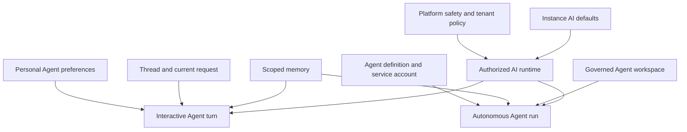

RevoEngine separates AI configuration into layers so administrators can govern the instance without erasing personal working preferences, while Autonomous Agents keep their own identity, memory, and file boundary.

<Note>
  Configuration is additive, not a permission shortcut. A global plugin, personal preference, memory entry, or workspace file never grants access that the current user or Agent service account does not already have.
</Note>

<span id="administrator-configure-ai-for-the-instance" aria-hidden="true"></span>
<span id="global-instructions" aria-hidden="true"></span>
<span id="default-plugins" aria-hidden="true"></span>
<span id="runtime-output-limits" aria-hidden="true"></span>
<span id="revoengine-docs-preview" aria-hidden="true"></span>
<span id="memory-policy" aria-hidden="true"></span>
<span id="storage-retention" aria-hidden="true"></span>
<span id="ai-security-rules" aria-hidden="true"></span>

<CardGroup cols={2}>
  <Card title="Configure instance AI" href="/ai/instance-ai-settings" icon="book-open">Set administrator defaults and policies for Interactive Agents.</Card>
</CardGroup>


## Configuration model

| Layer | Configured by | Applies to | Examples |
| --- | --- | --- | --- |
| Platform safety | RevoEngine and instance policy | Every Interactive and Autonomous Agent execution | Tenant isolation, authentication, approvals, blocked operations, runtime limits |
| Instance AI settings | Instance Administrator | AI work in the current instance | Global instructions, default plugins, plugin guidance, output ceiling, memory and retention policy, security rules |
| Personal Interactive Agent preferences | Individual user | That user's interactive workspace | Reasoning, planning preference, work mode, persona, and custom instructions |
| Thread or run configuration | User, operator, or automation | One interactive thread, message, or Autonomous Agent run | Selected model, explicit plugins, planning mode, current objective and attachments |
| Agent definition and policy | Agent operator | Every run of one autonomous Agent | Identity, mission, service account, Agent instructions, plugins, tool permissions, concurrency |
| Memory and workspace | Runtime and authorized operators | Future work within an exact owner scope | Stable learned knowledge, instruction files, reports, generated code, checkpoints |



The current instruction and verified tool results remain authoritative for the task. Imported preferences and memory provide context; they do not override safety, approval, identity, or exact runtime evidence.

## User: configure personal Interactive Agent defaults

Open **Settings → Personalization**. This is the current UI label for personal Interactive Agent preferences. These settings belong to the signed-in human account and shape new messages; they do not redefine an Autonomous Agent.

The workspace has **Defaults**, **Instructions** and **Memory** tabs with one **Save** action. Defaults control the response preferences below; Instructions holds personal guidance; Memory lets you inspect, replace or clear your own durable memory text. Memory is context, not an access grant or a replacement for the current request. See [1.5.0](/changelog/1.5.0) for the expanded personal AI workspace.

| Preference | Available behavior |
| --- | --- |
| Show progress | Shows intermediate Assistant activity; enabled by default when unset. It does not change reasoning effort, validation, or safety policy |
| Reasoning | `None`, `Low`, `Medium`, `High`, or `Extra high` as the default effort for new messages |
| Planner | `Standard` or `Review required`; the latter pauses after planning for an explicit review action |
| Work mode | `Balanced`, `Coding`, `Business`, `Analyst`, `Operator`, or `Creative` |
| Persona | Default, Friendly, Pragmatic, Professional, Concise, Calm, Mentor, or Assertive |
| Custom instructions | Up to 2,000 characters of account-level response guidance |

Personal custom instructions are useful for stable preferences:

```text
Lead with the result. For production changes, include validation and rollback.
Use English code identifiers but explain business impact in Polish.
```

Do not use personal preferences for project facts, passwords, one-off task requirements, or tenant-wide policy. Put the current requirement in the message, stable project context in scoped memory or workspace guidance, and organization-wide rules in instance settings.

### Per-turn overrides

The composer can override model, reasoning, planner behavior, permission level, or plugin selection for the current work. A per-turn choice changes that execution context without rewriting the saved account default. Permission choices are **Restricted**, **Auto Review**, and **Full Access**. Work mode, persona, and custom instructions remain account-level response preferences until changed in **Settings → Personalization**.

For example, keep **Medium + Standard + Auto Review + Balanced** as a daily default, then select **High + Review required + Restricted** for a risky cross-Component migration. Change Work mode to **Coding** in Settings if you also want to change that saved preference.

## Agent: define durable behavior

An autonomous Agent adds another stable layer that personal Assistant preferences do not provide:

- a named identity, mission, responsibilities, operating principles, and success criteria;
- a least-privilege service account used for runtime authorization;
- Agent instructions, model, reasoning, planning, and execution mode;
- Agent-owned and policy-managed plugin attachments;
- default and per-tool permission policy;
- concurrency, child-run, retry, inbox, and trigger behavior;
- scoped Agent memory and a governed workspace root.

The Agent definition is stable configuration. Memory, a workspace file, or a session checkpoint cannot silently rewrite its identity or mission. Update the definition deliberately and preserve the version and activity evidence.

See [Agent configuration](/ai/agent-configuration) for every field and [Autonomous Agents](/ai/agents) for the operational lifecycle.

## Memory: bounded learned context, not conversation history

Use memory only for concise information that should remain useful after the current thread or run:

| Scope | Example |
| --- | --- |
| `USER` | “Prefer concise release summaries with validation first.” |
| `AGENT` | “This Agent validates ledger totals against the settlement View.” |
| `WORKSPACE` | “Reports in this workspace use the approved quarterly template.” |

The runtime supplies at most one current digest for each active owner scope. Memory use remains bounded by scope, access, and instance policy.

Do not store secrets, full documents, transient progress, raw tool output, or reasoning in memory. Store exact content in Storage and keep only a concise convention or reference in memory.

## Workspace: the Agent's durable filesystem

Every successfully created Agent receives a managed workspace or can be linked to an authorized existing Storage folder. The linked root is an enforced boundary:

- listing, recursive name search, bounded reads, folder creation, upload, and artifact writes stay inside the root;
- the workspace root itself cannot be mutated by the Agent;
- another Agent's managed root cannot be attached as an ordinary shared folder;
- ordinary Explorer writes outside the root retain their normal permission and approval policy;
- downloads and administrative workspace operations still require authenticated Agent access.

Agents can use authorized guidance and files within the workspace root. Keep operator guidance concise, clearly named, and close to the work it governs; keep large reference material in separate files so it can be reviewed and maintained independently.

### Organize concurrent work

Use a predictable structure when an Agent delegates or resumes work:

```text
runs/<agentRunId>/        run-private notes and intermediate artifacts
shared/                   outputs intentionally shared between runs
AGENTS.md                 durable workspace guidance
deliverables/             reviewed final artifacts
```

Run lineage, inbox state, and session checkpoints coordinate execution. Workspace files are for durable content; memory is not a queue or distributed lock.

## Example enterprise setup

<Steps>
  <Step title="Set the tenant baseline">
    Add global engineering and data-handling instructions, attach the approved CRM and billing plugins, configure memory and artifact retention, and block prohibited external tools.
  </Step>
  <Step title="Let users personalize presentation">
    Each engineer selects a work mode, persona, default reasoning level, planner behavior, and concise custom instructions without changing tenant governance.
  </Step>
  <Step title="Create a reconciliation Agent">
    Assign a finance service account, define the reconciliation mission, attach only finance capabilities, and start with review-required mutations.
  </Step>
  <Step title="Use scoped state">
    Keep stable ledger conventions in Agent or Workspace memory, source files and reports in the Agent workspace, and active progress in the durable run checkpoint.
  </Step>
  <Step title="Validate the boundaries">
    Run one allowed read, one approval-gated write, one blocked operation, one memory recall, and one workspace artifact flow. Inspect the same run in Activity and Trace.
  </Step>
</Steps>

## Governance checklist

- Keep global instructions stable, short, and tenant-specific.
- Attach only active, reviewed default plugins.
- Treat plugin defaults as capability availability, not authorization.
- Keep personal preferences out of organization-wide policy.
- Use a dedicated service account for every production Agent responsibility.
- Store knowledge in memory and exact files in the workspace.
- Define retention for memory, exports, and Agent-created artifacts.
- Test allowed, approval-required, and denied operations after policy changes.
- Review Agent workspace ACLs before linking an existing folder.
- Correlate changes and runs through Activity, Trace, and durable execution history.

<CardGroup cols={2}>
  <Card title="Interactive Agents" icon="messages" href="/ai/assistant">
    Work in supervised, persistent threads.
  </Card>
  <Card title="Agent configuration" icon="robot" href="/ai/agent-configuration">
    Configure one autonomous Agent and its policy.
  </Card>
  <Card title="Memory and workspaces" icon="folder-tree" href="/ai/memory-and-workspaces">
    Choose the correct durable state boundary.
  </Card>
  <Card title="Instance settings" icon="sliders" href="/platform/instance-settings">
    Review all instance-wide controls.
  </Card>
</CardGroup>
