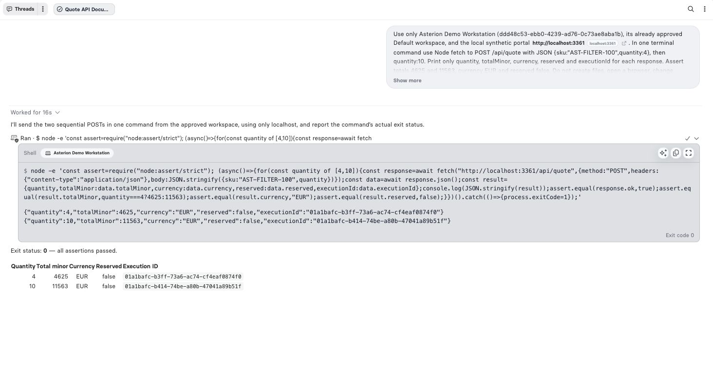

A terminal executes on your connected computer. Its conversation activity records the command and its outcome; application logs and Job history answer different questions. Start with [connection and permissions](/ai/terminals) and the [CLI commands](/developers/cli-terminal).

## Validate an integration from a workspace

In the Asterion sample, a developer checks a quote before changing the portal. The approved workspace contains the application, and **Local Access** permits its local HTTP service on a compatible runner. The task asks for two quote requests and fixed assertions, without placing an order.

```text
Use the approved Asterion workspace to check the quote service.
Quote AST-FILTER-100 at quantities 4 and 10.
Assert totals of 4625 and 11563 EUR minor units, and reserved=false.
Show the actual exit code and the observed values.
```

The verified execution returned:

| Quantity | Total in minor units | Display total | Stock reserved |
| --- | --- | --- | --- |
| 4 | 4625 | EUR 46.25 | No |
| 10 | 11563 | EUR 115.63 | No |

The command exited **0** after both assertions passed. Each response had its own Execution ID. This confirms the quote contract for those inputs; it does not confirm an order, invoice, or webhook delivery.

<Frame caption="Actual terminal command, captured output and exit code from the synthetic quote service.">
  
</Frame>

## Read the activity

Expand the work summary and the terminal action in the conversation. Inspect the selected terminal/workspace, command, captured output and completion state. A long-running command can remain active while the Assistant continues with other steps. Use its existing execution to inspect progress, send input where supported, or cancel it.

| Evidence | What it establishes | What to check next |
| --- | --- | --- |
| Command accepted | The runner accepted the action | Wait for its terminal state |
| stdout/stderr | What the process emitted | Check truncation and exit status |
| Exit code 0 | The program reported success | Confirm the assertion or durable business result |
| Nonzero exit | The program reported failure | Read the relevant output before retrying |
| Timeout or cancellation | Execution reached a stopping boundary | Inspect partial effects; do not assume rollback |
| Truncated output | The displayed evidence is incomplete | Use a narrower command or a small result file |

If a connection disappears after a write, recover the existing command status and inspect the destination before executing it again. A repeated shell command can repeat external effects.

## Other useful workflows

| Task | Suitable command outcome | Additional verification |
| --- | --- | --- |
| Run a repository test suite | Named tests and exit status | Review skipped tests and coverage of the changed behavior |
| Inspect a supplier CSV | Header, row count and a few sanitized rows | Validate types and rejected rows before importing |
| Generate an invoice preview | Local file and renderer success | Open the file; upload and finalize separately if needed |
| Debug a browser flow | Live page state and observed totals | Use [Live Preview](/ai/browser) for the actual controlled browser |
| Exercise an Endpoint | HTTP status, expected result, Execution ID | Follow any separately returned Job or delivery ID |

Avoid printing environment dumps, credentials, cookies or signed URLs. Commands can print sensitive content even when the command itself looks harmless.

## Distinguish three log surfaces

| Surface | Contents | Audience and use |
| --- | --- | --- |
| Conversation terminal activity | Command, captured output and execution state | Authorized conversation viewers; explain what the Assistant actually ran |
| CLI terminal operational log | UTC time, severity, correlation identifiers and selected lifecycle metadata | Runner owner; diagnose connection, policy, timeout and cancellation problems |
| Component application logs | Messages deliberately emitted with `api.log` | Authorized instance operators; investigate business execution |

The CLI operational log lives under the CLI configuration directory at `logs/terminal/<deviceId>/debug.log`. It records selected metadata such as exit code, timeout, truncation and browser action; it does **not** copy raw shell commands, stdout or stderr into that file. The conversation's captured output is a separate surface. Background service process logs are separate again.

Operational logs rotate daily, compress old files and retain archives for 30 days. Files are owner-readable/writable and directories are owner-only. Log rotation is not a substitute for keeping secrets out of command output.

## Write a useful application log

For a quote Component, record counts and totals instead of the whole request:

```typescript
api.log({
  message: 'Contract quote calculated',
  args: { lineCount: 1, totalMinor: 4625, currency: 'EUR' },
}, 'INFO');
```

[Native tests](/build/native-tests) show these diagnostic entries beside the corresponding case. For a running Endpoint or Job, use its Execution ID and [Observability](/operate/observability). A log message is diagnostic evidence; it cannot replace a passing assertion or a finalized Storage receipt.
