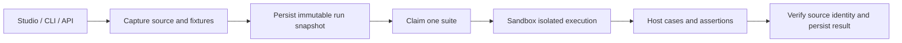

Native tests are Components of type **JavaScript Test** or **TypeScript Test**. A test Component is a suite: it contains named `test.case` cases, assertions and fixture configuration. It can be stored independently, reused by several Components and run without opening a coding session.

Use fixture suites for repeatable checks before deployment. Use reviewed integration tests when you deliberately need real external effects. A passing diagnostic run does not publish source or approve a later deployment.

## Choose what you are testing

| Entry point | Captured source | Result |
| --- | --- | --- |
| Studio, Default workspace → Tests | Stored authoring source plus all complete local working changes | Independent diagnostic run; editor session remains unchanged |
| Studio, a selected session → Tests | Saved session changes and its pinned runtime dependency context | Session TestRun eligible for the exact candidate, subject to policy |
| CLI, local worktree | Complete local Component files by name, overlaid on stored targets and configured libraries | Independent diagnostic run; no upload into Component source |
| CLI, `--remote` | Stored test and target authoring source | Independent diagnostic run |
| Platform API | Named suites, with optional complete source overlays | Durable run handle that can be executed, read, resumed or cancelled |

Independent runs test authoring source. They do not claim that the same source is active in production. Session deployment tests verify the saved candidate and its activation context. The two scopes are explicit; one result cannot silently approve the other.

## Write a reusable suite

Create a **JavaScript Test** or **TypeScript Test** Component and configure its mode, target names and named input fixtures. Test types appear in Component filters and Usage. They are not ordinary Job or Endpoint execution targets and are excluded from production library autoload.

For a Component named `Order pricing`, a test configuration can be:

```json
{
  "mode": "fixture",
  "targets": ["Order pricing"],
  "fixtures": {
    "normal": {"quantity": 2, "unitCents": 1250},
    "empty": {"quantity": 0, "unitCents": 1250},
    "invalid": {"quantity": -1, "unitCents": 1250}
  }
}
```

The target's `Main` element can contain:

```javascript
const { quantity, unitCents } = api.input();
if (!Number.isSafeInteger(quantity) || quantity < 0) {
  throw new Error('Quantity must be a non-negative integer.');
}
return { totalCents: quantity * unitCents };
```

The suite's `Test` element then exercises real target code:

```javascript
await test.case('normal order', async () => {
  const input = await test.fixture('normal');
  const result = await test.runComponent('Order pricing', input);
  await test.assertEqual(result.results.Main.totalCents, 2500);
});

await test.case('empty order', async () => {
  const result = await test.runComponent(
    'Order pricing', await test.fixture('empty')
  );
  await test.assertEqual(result.results.Main.totalCents, 0);
});

await test.case('invalid quantity rejects', async () => {
  const input = await test.fixture('invalid');
  await test.assertThrows(() => test.runComponent('Order pricing', input));
});
```

Await cases sequentially. If a case fails or its callback throws, later awaited cases still run and the suite remains failed. Concurrent or nested case registration is rejected. A suite with no cases or no assertions cannot pass. Returning `{ok: true}` is ordinary output, not runner evidence.

### Test methods

| Method | Purpose |
| --- | --- |
| `test.case(name, callback)` | Register and execute a named case |
| `test.fixture(name)` | Read a copied named JSON fixture |
| `test.runComponent(name, inputs)` | Execute a declared target from the captured manifest |
| `test.readComponent(name)` | Inspect captured Component source/configuration |
| `test.assertEqual(actual, expected)` | Compare values deeply |
| `test.assertTrue(value)` | Assert boolean conditions |
| `test.assertThrows(callback)` | Assert that an awaited operation throws |

The editor provides `test.*` completion, but the object is injected only by the native test runner. Ordinary low-code execution cannot create native testing authority or a passing TestRun.

## Understand API calls and effects



The platform resolves target names and libraries during capture. Each target invocation gets a child execution context with the same captured graph and remaining deadline. Nested local `api.executeComponent` calls cannot escape to newer source. An explicit version conflicting with the captured version is an error. The runner collects assertions on the host and the API verifies that returned evidence belongs to the dispatched snapshot.

| Surface | Fixture mode | Reviewed integration mode |
| --- | --- | --- |
| `api.input`, execution identity/context | Isolated invocation values | Invocation values under the approved principal |
| `util.*` | Local supported utilities, such as hashing, encoding and validation | The same utilities |
| `test.runComponent` and nested local execution | Captured source and target allowlist | Captured source and target allowlist |
| JSON-returning asynchronous `api.*`, `storage.*` and other effect methods | Matching fixture response; missing fixture fails before a real effect | Existing implementation and permissions |
| Vault-backed credentials | Real secret resolution is blocked | Existing explicit grants and redaction rules |
| Streaming or binary transfer methods | Unsupported; no real stream is opened | Existing runtime methods, where supported |
| Explicit remote execution | Unavailable; no local substitute | Unavailable in the current native-test rollout |

Ordinary JavaScript/TypeScript logic runs normally. Network, database or Storage effects are replaced only in fixture mode. `readOnly` alone is not treated as sufficient network isolation. Utilities do not become a route to fetch a real secret. Not every synchronous `api.*` helper is admitted in fixture mode; unsupported methods fail explicitly rather than execute a real operation.

### Mock an HTTP or Storage response

Add `effects` to the suite's named fixture configuration:

```json
{
  "mode": "fixture",
  "targets": [],
  "fixtures": {
    "effects": [
      {
        "scope": "api",
        "method": "httpCall",
        "args": [{"url": "https://erp.example/orders", "method": "GET"}],
        "result": {"data": {"orders": []}}
      },
      {
        "scope": "storage",
        "method": "getDocument",
        "args": ["order-fixture", {"format": "text"}],
        "result": {"content": "fixture text"}
      }
    ]
  }
}
```

```javascript
await test.case('ERP response', async () => {
  const response = await api.httpCall({
    url: 'https://erp.example/orders', method: 'GET'
  });
  await test.assertEqual(response.data.orders, []);
});

await test.case('Storage response and utilities', async () => {
  const text = await storage.getDocument('order-fixture', {format: 'text'});
  await test.assertEqual(text.content, 'fixture text');
  await test.assertTrue(util.isBase64('cmV2bw=='));
});
```

Matching uses the exact scope, method and argument values, including their order. The response is copied JSON. These fixtures are reusable static responses, not a sequence of consumable mocks; they do not provide call-count assertions or fixture-defined thrown exceptions. An unmatched call fails before contacting the real integration.

## Run from Studio

Open **Tests** from the Studio tools, including in **Default workspace**. The upper half lists native suites by name, with search and asynchronous loading of additional stored tests. Local test Components appear alongside stored suites. Choose one fixture suite or run a fixture collection. Integration suites remain visibly separate and require a reviewed Studio candidate.

The lower half shows compact runner results: suite status, duration, cases, assertions and errors. Resize the border between selection and results. Your normal code tabs, Working diff and buffers remain in the editor.

Running captures the current complete working changes. If an observed base changed remotely, capture fails before execution and preserves local work. Later edits make the displayed result stale for the current workspace; the original captured outcome remains readable. A disconnected client can resume the same run rather than quietly capturing different code.

## Run from a local worktree or CI

<Note>
  The commands below require an updated CLI build that includes Native Tests. They are available in the updated source build; the published `@revoengine/cli@1.0.28` does not include them. Studio and Platform API test execution do not depend on updating the CLI.
</Note>

The CLI uses the same host runner and source capture. It does not emulate the Revo runtime in Node or publish Components while testing.

```bash
# Inspect suites discovered from the configured local Component workspace.
revo tests list

# Send complete local source overlays and run a named fixture suite.
revo tests run "Order pricing tests"

# Run all local fixture suites, with machine-readable results for CI.
revo tests run --all --json

# Discover and run stored source instead of local worktree files.
revo tests list --remote
revo tests run "Order pricing tests" --remote --json

# Capture now, then resume execution by the returned run handle.
revo tests run --all --no-wait --json
revo tests resume "$RUN_ID" --json
revo tests cancel "$RUN_ID" --json
```

Use the ordinary CLI environment/auth configuration. Component names and source files are portable across instances; local instance IDs are not sent as source authority. A run tests the submitted local overlay against the selected target environment's captured dependencies. Review that target before running.

Collections larger than 20 suites execute sequential batches. Single-run JSON contains `runId`; collection JSON contains `runIds` and `executions`. Each handle retains its own captured source and results. Supply `--operation-id` with a UUID to retry the same selection and complete local source without creating duplicate captures. If collection stops, resume the retained handles or retry the original command with that operation ID.

Completed execution exits zero only for a passing run with real cases and assertions. Failed, incomplete, unavailable, aborted or cancelled outcomes are nonzero. `--no-wait` exits after successful capture: that receipt is not a test pass. Resume and collect terminal results before using them as a CI pre-deployment check. Diagnostic results do not replace candidate review or session-specific required evidence.

## Use the Platform API

1. `GET /native-tests` discovers suites with `search`, `take` and `skip`.
2. `POST /native-tests/runs` captures named suites and optional complete source overlays, returning a durable `runId`.
3. `POST /native-tests/runs/{runId}/execute` claims the next queued suite and waits for its bounded execution.
4. Repeat execution while suites remain queued. `GET /native-tests/runs/{runId}` reads progress or retained results.
5. `POST /native-tests/runs/{runId}/cancel` prevents remaining dispatch and stops collection of already running isolated work.

Paths are relative to your Platform API base. Capture uses an `operationId` UUID; an identical retry returns the same run. Reusing it for different input is rejected. Execution retries never dispatch a claimed suite twice. A lost runner becomes aborted rather than passing or silently replaying. An abandoned queued operation remains resumable; no background agent or scheduler is created to continue it.

Capture body for stored suites:

```json
{
  "operationId": "00000000-0000-4000-8000-000000000001",
  "testComponentNames": ["Order pricing tests"],
  "timeout": 10
}
```

`components` may supply complete source overlays, including test configuration, fixtures, all elements and changed libraries. Optional observed base name/version/digest fields make capture reject stale source. Use the generated OpenAPI schema for the exact request and result fields. Do not supply tenant, principal, Component IDs, authors or runner evidence.

All operations require current Component read access and run ownership. Integration is rejected by this independent fixture API. Retained diagnostic snapshots are private to the run owner and are cleaned up by configured maintenance retention, with a minimum of 90 days. In-flight bounded execution is protected and cleanup respects disabled garbage collection.

## Current execution boundaries

Each captured run is limited to 100 Components, 8 MiB of retained source and up to 20 suites. Studio and CLI fixture collections can dispatch sequential batches. The default deadline is 10 seconds per suite; callers may select up to 60 seconds. The runner also bounds cases, assertions and nested Component invocations.

Custom Node.js targets currently run in a restricted workspace module adapter. Node builtins, installed npm packages and arbitrary host filesystem access are unavailable. A passing result confirms the tested source in that managed environment, not native Node/provider parity. Remote native-test execution remains unavailable. Streaming/binary fixture parity is not implied by JSON effect fixtures.

Continue with [Studio sessions](/build/studio-sessions), [Components](/build/components), [CLI](/developers/cli) and the [Platform API](/api-reference/introduction).
