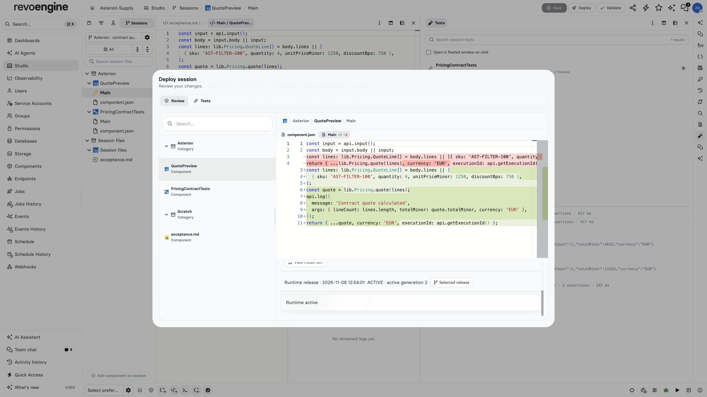

import { ScreenshotDetail } from "/snippets/screenshot-detail.jsx";

A source commit preserves reviewed code. Activation separately selects the runtime that executes it.

<Frame caption="The reviewed quote diagnostics change is active at generation 2. Source commit and preparation preceded activation.">
  
</Frame>

<ScreenshotDetail src="/images/asterion/studio-release-active.jpg" alt="Studio deployment review with quote source diff and runtime active generation 2" width={1920} height={1080} />

## Commit and activate

1. Save the shared draft and inspect the working diff.
2. Resolve base conflicts and run the required tests.
3. Freeze and approve the exact candidate.
4. Commit its sources and prepare the resulting runtime release.
5. Activate the chosen ready release against its expected active generation.

## Read preparation results

Preparation can return a saved **FAILED** result even when the HTTP request succeeds. Read the release status and diagnostics before activation. Source or library validation failures identify affected Components and require correcting the source and reviewing a new candidate. The full release is validated, including unchanged and inactive Components.

An explicitly retryable artifact failure uses a new preparation attempt for the same reviewed source manifest and retains the failed attempt. A changed source or invalidated candidate requires a new review. Repeating the same operation returns its saved result; it does not start another attempt.

## Review deletion drafts

A deletion draft can remove a Component whose old source is invalid. It must preserve the exact captured source, configuration and element identities until deletion is reviewed; it cannot combine removal with an unvalidated edit. The removed Component must be absent from the candidate graph, while all retained source still undergoes validation. Coverage exceptions require explicit review. Saving a cleanup draft does not delete or activate anything.

## Resolve activation conflicts

A source commit does not change the active runtime. The platform checks the committed dependency graph and reviewed manifest before runtime preparation and activation. If another release becomes active first, activation reports a conflict instead of silently combining releases. Saved releases and evidence remain available for review after reopening the session.

## Roll back runtime

Where your permissions allow rollback, choose **Roll back runtime** on a retained ready release and confirm the change. Rollback checks the observed active generation, changes the active runtime and preserves current source and unsaved draft changes. If the active runtime changes while confirmation is open, inspect the new state before trying again.

## Retain the deployed evidence

Successful activation archives the session. Instance retention settings govern later cleanup, with at least 90 days from the original activation. Logical deletion revokes session, share and owned Studio Chat access together, including new attachment reads. Physical attachment cleanup uses the existing Storage expiry lifecycle; previously issued signed download links retain their normal lifetime.

Cleanup removes only the verified session-owned chat and preserves linked Assistant conversations and protected runtime manifests. Deleting an activated session does not restart that period. Explicitly deleted drafts that were never activated use their deletion time for cleanup. Saved drafts do not expire merely because they are old.

## Continue a deployed change

After deployment, choose **Completed / archived** in the session picker, open **Manage** for the deployed session, then choose **Continue work** to create a new editable workspace linked to the original session and its deployed release; the original remains archived and read-only. Studio uses the retained deployed candidate, skips deleted Components and observes the current source versions. If current Component content has changed, or retained deployment evidence is unavailable, reconcile that state before continuing.

The original workspace stays archived; deployed work cannot be reopened in place. The link identifies the release being continued, which may differ from the runtime active now.

Continuing does not activate another release or copy participants.

## Fork a draft

**Fork session** remains a separate copy of the captured draft. The API's omitted fork mode defaults to this copy behavior; use `mode: "continue"` for deployed continuation. The original session and release history remain available in either workflow.

## Continue the Assistant conversation

An existing Assistant conversation keeps its original workspace. To carry private conversation context into the new child, its owner explicitly forks from a saved Assistant response and selects that child workspace. Fresh editing access is required; a conversation already bound to a workspace can target only its direct child. The fork preserves task instructions and response format, while inherited private history remains private.

Other session members do not gain that history, and a shared conversation owned by another account cannot use this override. The old conversation can read retained archived evidence and finish an answer, but cannot edit, run tests or start another deployment there.

Continue with [Studio](/build/web-ide), [Components](/build/components) or the [Platform API](/api-reference/introduction).
