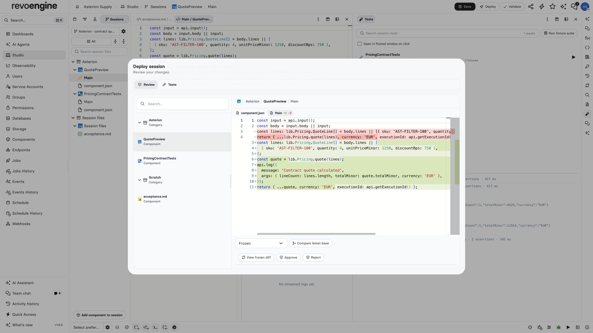

import { ScreenshotDetail } from "/snippets/screenshot-detail.jsx";

Tests and approval belong to the captured candidate. Editing source can invalidate older evidence.

<Frame caption="Review the exact quote change before approving it. Passing tests and a source review answer different questions.">
  
</Frame>

<ScreenshotDetail src="/images/asterion/studio-review-diff.jpg" alt="Frozen Studio proposal showing a source diff and Approve or Reject controls" width={1920} height={1080} />

## Test and review

For independent fixture runs from Default workspace, the CLI or Platform API, see [Native tests](/build/native-tests). The workflow below describes evidence for a saved session candidate.

Use **JavaScript Test** or **TypeScript Test** Components for reusable tests. A test suite is a standalone Component. Its `testConfig.targets` lists the names of the Components it tests, while named fixtures provide test inputs and `mode` selects fixture or integration execution. A newly created session test is a saved workspace draft and becomes an ordinary Component when its sources are committed. Studio authoring filters and Usage expose Test types; Job and Endpoint execution selectors exclude them. The shared editor declaration provides `test.*` completion, but that runtime object exists only during native test execution. Ordinary low-code cannot use it to obtain testing authority.

Choose a suite by name in the Tests window and run it, or run the session fixture suite collection. Models use the same operations. Tests do not automatically execute on every editor change; freeze requires current evidence for the tests mandated by policy.

The same **Tests** window shows suite selection and execution above a compact result tree below. Both areas start at 50/50; resize the separator with the pointer or ArrowUp/ArrowDown. Results show status, executed cases, assertion counts and duration, and distinguish current evidence from earlier runs. Deployment review reuses the read-only results for its exact frozen candidate.

Tests use the active parent release plus the business changes staged in the session. Unchanged libraries and targets retain their active runtime binding; merely adding a file to the session does not deploy it. A target with no usable active binding is rejected until it can be tested against the required runtime.

Results belong to the source and dependencies actually tested; earlier evidence cannot approve changed code.

Integration effects require separate approval for the exact frozen candidate and selected test. Fixture execution does not silently permit live effects.

Cancel a queued test before execution, or stop collecting the result of a running test. Stopping collection cannot roll back integration effects that have already been dispatched.

Use component names in native test code. Both `test.runComponent(name, inputs)` and `test.readComponent(name)` resolve the exact captured workspace, preserving its source and dependency versions.

```javascript
await test.case('empty order', async () => {
  const input = await test.fixture('empty');
  /** @type {{results: {Main: {totalCents: number}}}} */
  const result = await test.runComponent('Order pricing', input);
  await test.assertEqual(result.results.Main.totalCents, 0);
});
```

The current controlled rollout runs Custom Node.js test targets in a restricted workspace module adapter, in both fixture and integration modes. Node builtins and installed npm packages are unavailable there. Local nested test calls use the captured overlay. Calls explicitly requesting a remote execution host return **UNAVAILABLE** in both modes and do not run a local replacement. Catching that error or passing other assertions cannot produce passing remote evidence. Local results confirm the tested source in that managed runtime; they do not confirm native Node compatibility or execution on a remote provider. Those capabilities require separate rollout validation.

Plan smaller test workspaces when their Components and Libraries exceed a runner limit. Review capture retains the complete workspace within its aggregate source-size bound; freezing a candidate does not trim it to an isolated execution budget.

Freeze the saved draft for review. Reviewers inspect the complete changes, intent, validation and test evidence. Where policy allows an exception, record its reason against the candidate. Permissions, version conflicts and invalid source cannot be bypassed by a test waiver.

Continue with [commit and activation](/build/studio-session-release).
