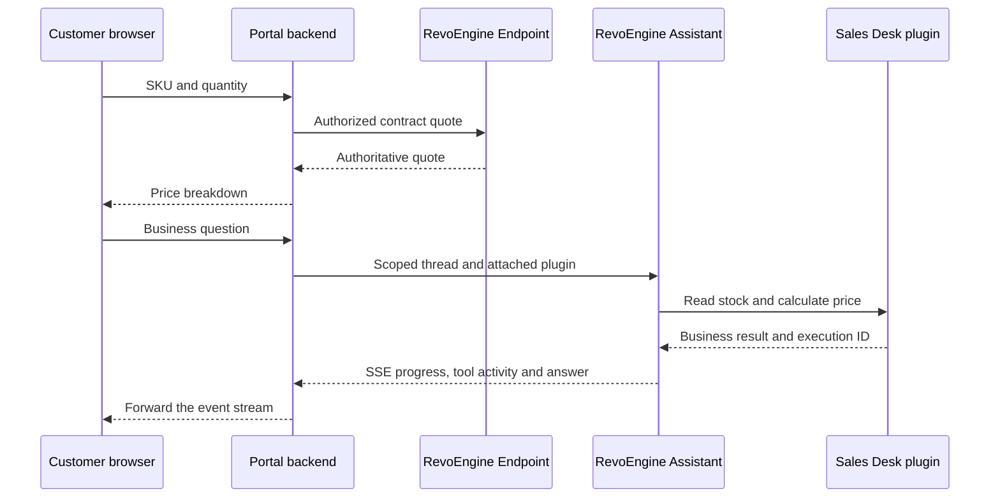

An external application can combine ordinary RevoEngine Endpoints with an Assistant conversation. The Asterion portal uses an Endpoint for deterministic price calculations and a Component tools plugin for conversational stock and pricing questions. Both call the same [Pricing Library](/build/library-authoring).

<Frame caption="A real local portal: the product form and AI Sales Desk return the same 46.25 EUR contract quote. The product drawing is illustrative; prices, stock and tool activity come from the running synthetic instance.">
  
</Frame>

## Keep authority on the server



Create a dedicated portal service account and a scoped key. Store it only on the backend. Resolve the buyer from the portal's authenticated session, authorize access to that buyer, and choose the matching business tools on the server. Never let a browser choose a platform identity, arbitrary plugin, permission level or another customer's thread ID.

The local example represents one fictional buyer and uses two read-only plugin actions. It does not implement multi-customer login, checkout or payment. Adding those requires application authentication and authorization in addition to platform permissions. See [authentication](/developers/authentication) and [service accounts](/operate/service-accounts).

## Calculate the form quote through an Endpoint

Expose `SalesTools` through a POST Endpoint such as `/asterion/contract-quote`. Send the SKU and quantity through your backend; the Component resolves contract pricing. For the seeded buyer, this input:

```json
{ "sku": "AST-FILTER-100", "quantity": 4 }
```

produces a quote containing:

```json
{
  "sku": "AST-FILTER-100",
  "quantity": 4,
  "unitPriceMinor": 1250,
  "discountBps": 750,
  "totalMinor": 4625,
  "currency": "EUR",
  "reserved": false
}
```

Do not send `unitPriceMinor` or `discountBps` as buyer-controlled authority. A quote is provisional; reserving inventory is a separate transaction with its own authorization and idempotency key. [Endpoint runtime](/developers/endpoint-runtime) explains request input and response handling.

## Start a scoped Assistant stream

The following server-side function forwards an already authenticated portal request to RevoEngine. Its caller must authenticate and authorize the buyer, enforce request-size and rate limits, and restrict CORS/CSRF according to the portal's session model. The key and attached plugin below are configured for the single demo buyer; substitute a buyer-scoped design before serving multiple customers.

Set `REVO_API_URL` to the API origin, `REVO_INSTANCE` to the instance ID, `REVO_PORTAL_KEY` to the service-account key, and `REVO_SALES_PLUGIN_ID` to the reviewed plugin ID. Keep these values out of frontend builds and logs.

```js Portal backend · Node.js
import { once } from 'node:events';

export async function streamSalesDesk(message, response) {
  if (typeof message !== 'string' || !message.trim() || message.length > 1200) {
    response.writeHead(400, { 'content-type': 'application/json' });
    response.end(JSON.stringify({ error: 'Enter a question up to 1200 characters.' }));
    return;
  }
  const controller = new AbortController();
  response.on('close', () => {
    if (!response.writableEnded) controller.abort();
  });
  try {
    const upstream = await fetch(
      new URL('/api/v1/assistant/threads/stream', process.env.REVO_API_URL), {
        method: 'POST',
        headers: {
          Authorization: `Bearer ${process.env.REVO_PORTAL_KEY}`,
          instance: process.env.REVO_INSTANCE,
          'content-type': 'application/json',
        },
        body: JSON.stringify({
          version: 'v2', executionMode: 'interactive', permissions: 'default',
          model: process.env.REVO_AI_MODEL || 'gpt-6-luna', reasoningEffort: 'low',
          pluginIds: [process.env.REVO_SALES_PLUGIN_ID],
          toolNames: ['plugin_load', 'plugin_call'],
          content: 'Use the attached Sales Desk business tools to verify prices and stock. ' +
            'This demo represents one buyer. Do not reserve, order or change data. ' +
            'Return EUR amounts and the execution identifier. Customer question: ' + message,
        }),
        signal: AbortSignal.any([controller.signal, AbortSignal.timeout(300000)]),
      },
    );
    if (!upstream.ok || !upstream.body) throw new Error('Assistant unavailable');
    response.writeHead(200, {
      'content-type': 'text/event-stream', 'cache-control': 'no-cache',
      'x-accel-buffering': 'no',
    });
    response.flushHeaders();
    for await (const chunk of upstream.body) {
      if (!response.write(Buffer.from(chunk))) {
        await once(response, 'drain', { signal: controller.signal });
      }
      if (response.destroyed) break;
    }
    response.end();
  } catch {
    if (response.destroyed) return;
    if (response.headersSent) {
      response.write('event: error\ndata: {"message":"Sales Desk unavailable"}\n\n');
      response.end();
    } else {
      response.writeHead(502, { 'content-type': 'application/json' });
      response.end(JSON.stringify({ error: 'Sales Desk unavailable' }));
    }
  }
}
```

The prompt communicates the task. The service account, resource access, attached plugin contract and actual Component implementation provide the authorization boundary. A read-only prompt alone is insufficient.

## Render events as they arrive

SSE is a sequence of events, not one JSON response. A chunk can contain half an event, several events or part of a UTF-8 character. Use a streaming decoder and retain incomplete frames. This client calls a same-origin backend route that invokes the function above:

```js Portal browser · SSE consumer
export async function askSalesDesk(message, onEvent, signal) {
  const response = await fetch('/api/assistant', {
    method: 'POST', headers: { 'content-type': 'application/json' },
    body: JSON.stringify({ message }), signal,
  });
  if (!response.ok || !response.body) throw new Error('Sales Desk unavailable');
  const reader = response.body.getReader();
  const decoder = new TextDecoder();
  let buffer = '', completed = false;
  function dispatch(frame) {
    const lines = frame.split('\n');
    const event = lines.find(line => line.startsWith('event:'))?.slice(6).trim();
    const data = lines.filter(line => line.startsWith('data:'))
      .map(line => line.slice(5).trimStart()).join('\n');
    if (!event || !data) return;
    const payload = JSON.parse(data);
    if (event === 'error') throw new Error(payload.message || 'Assistant failed');
    if (event === 'message.completed') completed = true;
    onEvent(event, payload);
  }
  try {
    for (;;) {
      const { done, value } = await reader.read();
      buffer += done ? decoder.decode() : decoder.decode(value, { stream: true });
      buffer = buffer.replace(/\r\n/g, '\n');
      if (buffer.length > 1024 * 1024) throw new Error('SSE event exceeds portal limit');
      let boundary;
      while ((boundary = buffer.indexOf('\n\n')) >= 0) {
        dispatch(buffer.slice(0, boundary));
        buffer = buffer.slice(boundary + 2);
      }
      if (done) break;
    }
    if (!completed) throw new Error('Connection ended before a completed answer');
  } finally {
    await reader.cancel().catch(() => undefined);
    reader.releaseLock();
  }
}
```

| Event | Use in the portal |
| --- | --- |
| `thread.created` | Retain `payload.thread.assistantThreadId` in a server-owned mapping to the authenticated buyer. |
| `tool.started` | Show an activity label from `payload.provider.label` or `payload.operation.label`. |
| `tool.completed` | Record `toolExecutionId`, `toolStatus` and the business action; completion is not a reservation. |
| `message.delta` | Append `payload.delta` as text while the answer streams. |
| `message.completed` | Replace the draft with **`payload.message.message`**. The final text is not in a `content` field. |
| `artifact.persisted` | A durable artifact is available subject to access checks; tool completion alone does not establish this. |
| `error` or an early disconnect | Keep the partial result visibly incomplete and offer a controlled retry. |

Render text with `textContent` or a reviewed Markdown renderer. Do not insert raw model output as HTML. If the stream pauses for a decision, use the supported approval/clarification flow or explain the pending state; do not auto-approve a write to make the portal look successful.

## Retain evidence without crossing owners

A thread created by the portal service account belongs to that identity. A regular operator's conversation link does not automatically grant access to it. The Asterion portal provides a scoped receipt with the completed answer and its business-tool execution identifiers; it does not expose a private diagnostic export.

For continuing conversations, map the server-owned thread ID to the authenticated buyer before calling the message-stream operation. Never accept an arbitrary thread ID from a browser and forward it with a more privileged key. Decide separately whether a disconnected request should stop or continue as background work, and design billing, timeout and cancellation around that choice.

## Verify the integration

Exercise the same SKU and quantity through the form, portal Assistant and attached-plugin Agent. Compare the returned quote and inspect actual tool executions. Test an invalid SKU, invalid quantity, unauthorized buyer, provider error, disconnect and partial stream. Confirm that the browser's network traffic and frontend source contain no platform key.

In the local example, the form and both AI surfaces returned 46.25 EUR for four units. Changing the form to ten units returned 115.63 EUR. No quote reserved inventory. Continue with [business plugins](/ai/business-plugins), [browser verification](/ai/browser) and [Asterion operations](/platform/asterion-supply).
