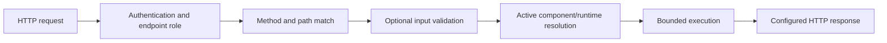

The Endpoint runtime is the execution front door for HTTP routes configured in RevoEngine.

## Control plane versus runtime

- Create, update, inspect, activate, and disable definitions through `/api/v1/endpoints` on the [Platform API](/developers/platform-api).
- Invoke the configured method and path on the instance's Endpoint runtime origin.
- Retrieve a generated OpenAPI document with `GET /api/v1/endpoints/openapi`, or one endpoint with `GET /api/v1/endpoints/{endpointId}/openapi`.

Read the Endpoint runtime origin from your instance configuration. Do not derive it from the Platform API hostname.

## Invoke an endpoint

Given an active `POST /orders/:orderId/confirm` definition:

```bash
curl "$REVO_ENDPOINT_URL/orders/order-123/confirm?notify=true" \
  --request POST \
  --header "Authorization: Bearer $REVO_API_KEY" \
  --header "Content-Type: application/json" \
  --data '{ "channel": "email" }'
```

The runtime matches the HTTP method and path, preferring the most specific active definition. Static and named dynamic path segments are supported. A missing active match returns `404`.

## Request processing



Component code can read request body, query, path values, sanitized headers, and endpoint template inputs through its execution input/context. Authorization and platform-internal headers are not exposed to customer code.

### Read named path parameters

For `POST /orders/:orderId/confirm`, use the named `parameters` map. The legacy `params` array contains positional values and has no `orderId` property.

```js
const input = api.input();
const orderId = input.parameters.orderId;
return { orderId, channel: input.body.channel };
```

## Caller and execution account

An Endpoint's saved `executionPolicy` chooses whether its runtime operations use the caller or a Service Account. Set defaults in **Settings → Endpoints**, then override individual Endpoints when necessary. The authenticated caller needs `ENDPOINT_INVOKE` or `INSTANCE_ADMIN`; a human application user can invoke Endpoints with platform access disabled. Invocation access does not grant access to Databases, Storage, Users, or other operations inside the Component.

In `CALLER` mode, those operations use the caller's current roles and resource ACLs. In `SERVICE_ACCOUNT` mode, they use the selected account's current roles and resource ACLs. An administrator caller uses their own permissions in `CALLER` mode without Service Account code approval. A Service Account must be active and have platform access in either mode.

Existing instances without saved execution settings automatically retain their application behavior with System as execution authority and the invoking user as business identity. Existing executable versions remain available and Job defaults stay unchanged. Explicit saved settings are preserved; new instances start with Caller Endpoint authority.

`api.currentUser()` defaults to the invoking business user, even when a Service Account performs resource operations. Choose `EXECUTION_ACCOUNT` in the instance or Endpoint policy only when the Component should see that executor instead. The audit trail keeps the initiating caller separately from the execution account. See [Endpoint configuration](/operate/endpoint-configuration#execution-policy) for policy fields and code approval for configured administrator Service Accounts.

For example, an application user invokes a reporting Endpoint as **System + Caller**. Database queries execute with System's permissions, while `api.currentUser().userId` remains that application's user ID for existing filters and business attribution. Changing only the execution identity does not change authorization. Direct Platform API, MCP, and ad-hoc Sandbox calls continue to use their authenticated caller; Endpoint defaults apply to saved Endpoint execution.

## Validation

An Endpoint can validate its input with an inline guard or a JSON-validator component. Configure the failure status/body independently from the successful response. Validate both accepted and rejected payloads before activation.

Prefer equivalent `enum`/`const`, type, length, numeric bounds and supported date/time rules before adding a regex to a guard. Even one simple pattern can roughly double request-preparation time or more for small inputs; this is not a fixed multiplier for total HTTP latency. Preserve required validation semantics and bound string length when a pattern is necessary. See [rule selection and measured examples](/low-code/json-validator#choose-explicit-rules-before-regex).

<span id="response-modes" aria-hidden="true"></span>

## HTTP and SSE response modes

An Endpoint selects one mode with `options.responseMode`: `http` (default) or `sse`.
Method, route, guards, authorization and execution policy are shared. See
[HTTP responses](/operate/endpoint-http) for a single response and
[SSE streams](/operate/endpoint-sse) for live events, final results, disconnect
policies and cursor recovery. The
[OpenAI tools example](/operate/sse-openai-example) combines outbound model streaming
with application-owned Endpoint events.

### HTTP response selection

An Endpoint may return:

- its component result map when clients explicitly need multiple visible results;
- preferably, one exact visible result selected by `popResult` for a new endpoint with a body;
- an empty body with `noResult`;
- a configured static response when no component is attached;
- an explicit status and body produced by runtime `api.throw(...)`;
- a legacy envelope only when an existing integration still requires `legacyResults`.

Configured normal response codes are successful `2xx` values. A component can deliberately return another code through `api.throw(status, body)`.

<Warning>
  Endpoint invocations are not retried automatically. After a timeout or upstream failure, a mutation may already have reached a database or external provider. Verify state before retrying a non-idempotent call.
</Warning>

## Version and readiness

Low-code Endpoints omit `componentDigest` to follow the latest active revision, or use a verified content digest for a controlled rollout across instances. Preserve an existing binding unless the change is intentional. Custom Node.js endpoints execute the component's selected ready runtime revision; they do not run newly saved source until its deployment is ready and active. If no usable runtime revision exists, invocation fails explicitly. For configured execution as an administrator Service Account, approval covers the selected ready runtime revision; pending source does not replace it or grant its artifact approval.

When a Component is repaired, inspect dependent Endpoints, Job Templates, and Agent Tools. Latest-bound dependents follow the repaired version and require contract validation; pinned dependents remain unchanged. Do not migrate existing dependents to a different version without an explicit compatibility decision.

## Observability

Every invocation receives an Execution ID and a separate distributed operation identifier. Capture response status, timestamp, endpoint ID/version, and the `x-revo-oid` response header when requesting support. Never capture the bearer credential.
