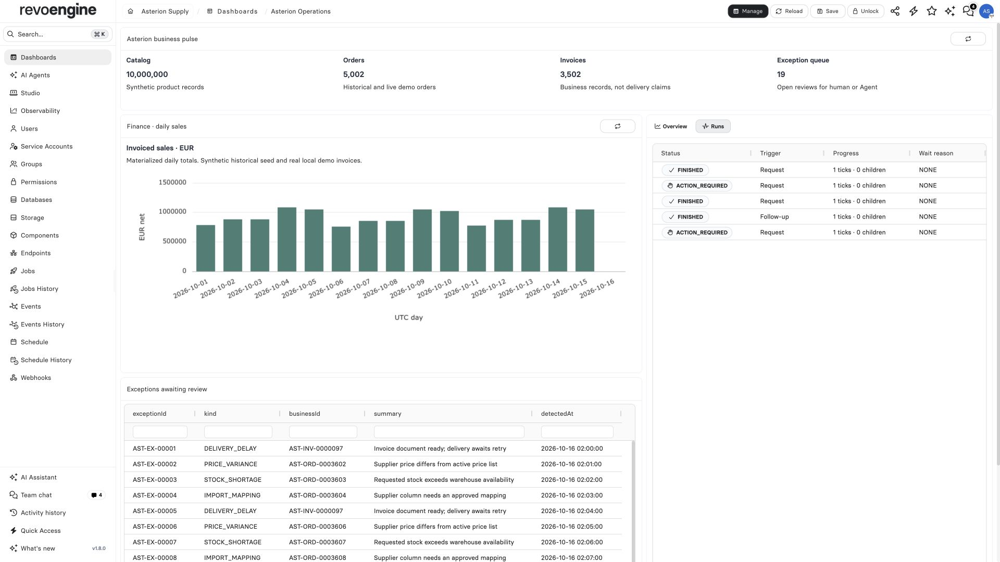

import { ScreenshotDetail } from "/snippets/screenshot-detail.jsx";

Dashboards turn the RevoEngine control plane into an operator-specific workspace. A dashboard can combine live resource grids, performance and identity charts, Trace, Storage, and custom widgets on one movable grid.

<CardGroup cols={2}>
  <Card title="Built-in widget library" href="/widgets/dashboard-library" icon="book-open">Choose a built-in dashboard panel and its source.</Card>
  <Card title="Configure a Custom Widget" href="/widgets/source-configuration" icon="book-open">Choose Inline or Component sources, inputs, execution limits and revisions.</Card>
</CardGroup>

<Frame caption="A synthetic operations dashboard combines counts, business trends and Agent run state. Each widget still has its own source and permissions.">
  
</Frame>

<ScreenshotDetail src="/images/asterion/operations-dashboard.jpg" alt="Asterion operations dashboard with catalog, orders, invoices, exception counts, trend chart and Agent runs" width={1920} height={1080} />

## Create a dashboard in the app

1. Open **Dashboards** and select **Manage**. Use **Add dashboard** (`+`) in the search field.
2. Enter a name (3–60 characters), an optional description (up to 1000 characters), and choose **Global** and **Default** only when their visibility or default behavior is intended. Select **Save**. The new dashboard opens empty.
3. Select **Unlock**, then **Widgets**. Search the library, use a widget's **Add** button or drag it onto the grid. Drag insertion previews how existing widgets will move.
4. Select **Configure** on the new widget. Its tab opens in the widget panel; set the source and any controls listed below. Move or resize the widget while the grid is unlocked. A newly added widget waits for configuration before its content becomes interactive.
5. Select the dashboard **Save** button to persist the complete layout and current built-in grid filters and sort. Select **Lock** to return to the operator view. Locking alone does not save edits.

Use **Manage** to open, search, rename, change visibility/default, or delete a saved dashboard. **Home** is the built-in view; create a named dashboard before adding widgets. **Reload** discards unsaved layout changes and reloads the saved preference. The grid has 20 columns; palette sizes are starting footprints and may be enlarged for dense data. Widgets are shown only when the viewer has their required roles and resource access.

## Embed an external frontend

Add an **Iframe** widget to a named dashboard. In **Configure → Iframe**, enter the external app's HTTPS URL, choose an isolation profile and select **Apply**. Select the dashboard **Save** button to keep the URL and profile. To clear the source, leave the URL empty and apply the change.

| Profile | Browser behavior |
| --- | --- |
| **Static** | Displays the page with scripts and forms disabled. |
| **Isolated scripts** | Runs scripts with an opaque origin. |
| **Application origin** | Runs scripts and forms with the external app's own origin. Use it for a trusted frontend whose APIs authorize that origin. |

The external site must allow the RevoEngine app to frame it. For cross-origin requests to the Endpoint runtime or another API, configure that API's CORS policy for the frontend origin and use the app's own authentication. Dashboard viewers still need permission for the actions they perform. Keep credentials out of the saved URL. All profiles sandbox the frame and block top-level navigation and pop-ups.

## Combine business operations with AI

The [Asterion Supply example](/platform/asterion-supply) combines four live widgets: catalog/order/invoice counts, daily sales from a Materialized View, an exception View, and the finance Agent. Select the Agent in **Configure → Agent** to inspect its runs and workspace evidence beside business data. Its presence on a dashboard does not grant the viewer permission to run it.

A pinned Assistant conversation is a separate conversation surface; it is not an additional dashboard widget type. Use the current **Agents** widget for Agent operations and link business work to its verified run or artifact.

## Refresh and source of truth

A dashboard is presentation, not a separate data store. Embedded grids reload through their owning APIs; custom widgets execute their inline code or Component according to widget refresh settings. If a number looks stale, check the owning Table/view, Endpoint, Job, cache, or widget result.

For expensive repeatable aggregation, build a materialized view and refresh it through a [Schedule](/operate/schedules). The dashboard then reads a governed precomputed result instead of repeatedly scanning the same large dataset.

## Real use case: order operations

An order-operations dashboard can combine:

- an Endpoint performance panel filtered to checkout routes;
- a Database Data panel showing orders stuck in `PROCESSING`;
- Job History filtered to reconciliation failures;
- Webhooks filtered by warehouse correlation metadata;
- a custom widget summarizing balances, orders, and unsettled transactions.

Operators begin with the decision surface and open the underlying row, Job, or Trace only when investigation is required.

## Failure semantics

- **Widget error** means its inline code, Component, or result contract failed; inspect widget input and execution evidence.
- **Empty widget** can be an intentional `EMPTY` result; distinguish it from loading and failure.
- **Stale grid** requires a source/API check; moving or re-saving the panel does not refresh authoritative data.
- **Reload** discards unsaved layout changes and reloads the saved preference.
- **Concurrent edit** is protected by dashboard versioning; reload before overwriting a newer preference.

## Production checklist

- Give each dashboard one operational purpose.
- Expose decisions and exceptions, not raw volume alone.
- Keep filters, time range, and environment clear.
- Pin consequential reusable widgets to reviewed Component revisions; review inline code before sharing a dashboard.
- Set refresh intervals according to source cost and freshness needs.
- Test with an operator's actual roles and ACLs.
- Link panels to underlying Job, resource, or Trace evidence.
- Lock and save the final layout.

See [Observability](/operate/observability) for incident workflows and [Limits and quotas](/platform/limits-and-quotas) for runtime boundaries.

## Enterprise example

[Asterion Supply](/platform/asterion-supply#put-operations-and-ai-on-one-dashboard) combines live KPI and sales widgets, a native Agent runs widget and an exception View. The separate [customer portal](/developers/customer-ai-portal) uses the same business rules through Endpoints and AI plugins.
