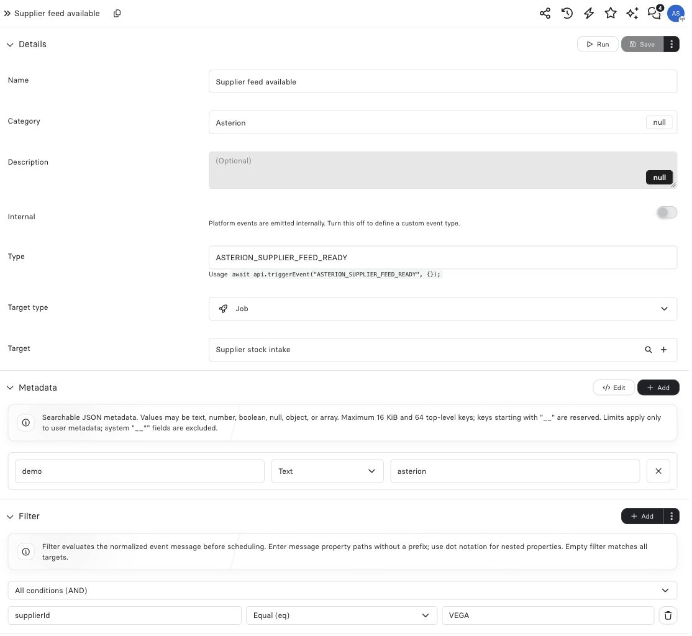

import { ScreenshotDetail } from "/snippets/screenshot-detail.jsx";

import { FilterDemo, PlaygroundStyle, routeExample } from "/snippets/revo-playground.jsx";

## Example: admit one supplier feed

The Asterion subscription listens for `ASTERION_SUPPLIER_FEED_READY` and targets **Supplier stock intake**. Its filter compares the message's `supplierId` with `VEGA`. An occurrence for another supplier does not reach this target. Definition metadata `demo: asterion` helps operators find the subscription; it is not the message's supplier identity.

<Frame caption="The Event definition separates searchable metadata, a message predicate and the target Job.">
  
</Frame>

<ScreenshotDetail src="/images/asterion/event-filter-and-metadata.jpg" alt="Supplier feed Event targeting a Job, with demo metadata and supplierId equal VEGA filter" width={1114} height={1024} />

## Explore the behavior

<FilterDemo />

## Filter event messages

The visual filter builder supports **all**, **any**, and **none** matching. Select **Browse history** beside a condition to browse Events of the configured type, including Events that did not match the current filter. Select a row to inspect its JSON, then click a field to fill the condition. Set the operator and comparison value in the Event form.

The builder uses the same JSON Pointer format as **Grouping key path** for Batch and Debounce and **Dynamic key path** for Jobs. A field displayed as `message.pricelists[0]` becomes `/message/pricelists/0`. The filter tests the selected value, while grouping and concurrency use a scalar value as a key.

For a CSV ingestion subscription, configure all conditions:

```text
/message/mimeType          eq       text/csv
/message/metadata/pipeline eq       settlements
/message/name              ilike    settlement-*.csv
```

Use `/metadata/pipeline` to select metadata on the published Event. Use `/message/metadata/pipeline` when the publisher put it inside the message. Wildcard text entered as `*` is normalized to the query wildcard.

### Filter operators

| Operator | Behavior |
| --- | --- |
| `eq`, `ne` | Exact JSON-value equality or inequality. |
| `gt`, `gte`, `lt`, `lte` | Numeric comparison; non-numeric values do not match. |
| `in`, `notIn` | Exact comparison against a required array of candidates. |
| `isNull`, `isNotNull` | Tests missing/`null` versus a present non-null value; no comparison value is required. |
| `contains` | Substring, array-member, or partial object containment according to the actual value type. |
| `startsWith`, `endsWith` | Case-sensitive string boundary match. |
| `like`, `notLike` | SQL-style `%` and `_` pattern match. The UI converts `*` to `%`. |
| `ilike`, `notILike` | Case-insensitive pattern match. |

Event filters can address `/message`, `/metadata`, or `/type`. Paths allow up to 12 segments and 256 characters for JSON Pointer, including array indexes. Encode a literal slash as `~1` and a literal tilde as `~0`. Prototype-related keys are rejected.

The Platform API accepts nested `and`, `or`, and `not` groups. Existing dotted fields such as `message.order.region` remain valid. The visual builder preserves saved conditions beyond its editing capabilities.

```json
{
  "or": [
    { "field": "/metadata/source", "op": "eq", "value": "checkout" },
    {
      "and": [
        { "field": "/type", "op": "eq", "value": "ORDER_APPROVED" },
        { "field": "/message/order/region", "op": "in", "value": ["eu", "uk"] }
      ]
    }
  ]
}
```

<Warning>
  A filter is an admission rule, not a data validator. Validate the complete business payload in the target Component before creating side effects.
</Warning>

Continue with [events](/operate/events).
