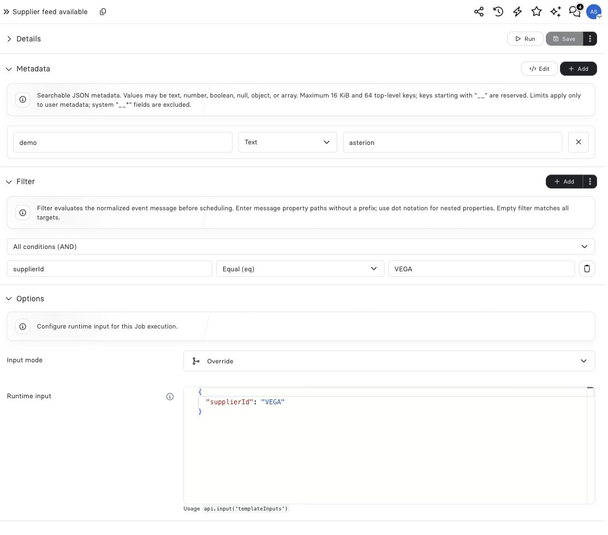

## Example: configure the supplier input

After the supplier predicate matches, this sample uses **Override** to supply `{ "supplierId": "VEGA" }` as runtime input to **Supplier stock intake**. The Job reads `api.input('templateInputs')`. The message filter decides whether dispatch is eligible; the input mode decides what the selected Job receives. Changing one does not automatically change the other.

<Frame caption="Filter, input mode and JSON input are separate configuration controls.">
  
</Frame>

## Configure Runtime input for a Job target

Select a Job target, then use the expanded **Options** section at the bottom of the Event editor. **Runtime input** uses the same JSON-object editor as Job templates. The **Input mode** dropdown shows **Override**, **Deep Override** and **Replace**, with icons and descriptions.

| Mode | Effective `templateInputs` |
| --- | --- |
| **Override** (default) | `{ ...jobTemplateInput, ...eventInput }`: Event keys take precedence; other Job defaults remain. |
| **Deep Override** | Recursively combines nested objects with automation values taking precedence. Arrays are replaced in full; `null` stays a value. |
| **Replace** | Only the Event input. An empty `{}` removes all Job template defaults for this execution. |

Override is shallow: a supplied nested object or array replaces the whole value at that key. Values such as `false`, `0`, and `null` inside the object are retained. The root must be an object; arrays, strings, numbers, and `null` are rejected.

Use **Deep Override** to change part of a nested configuration. For example, Job defaults `{ "export": { "format": "csv", "encoding": "utf8" } }` and automation input `{ "export": { "format": "xlsx" } }` produce `{ "export": { "format": "xlsx", "encoding": "utf8" } }`. An empty nested object preserves existing nested values; a change of value type replaces the whole value. Arrays are never concatenated, and `null` does not delete a field. Existing **Override** and **Replace** behavior is unchanged.

For example, a Job template with `{ "region": "eu", "mode": "incremental" }` and an Event with `{ "mode": "full" }` in Override mode execute with `{ "region": "eu", "mode": "full" }`.

The Platform API uses these fields on the Event definition:

```json
{
  "input": { "mode": "full" },
  "inputMode": "override"
}
```

Read the resolved values in the Component:

```js
const templateInputs = api.input('templateInputs');
const message = api.input('message');
```

Event Runtime input configures `templateInputs`; it does not replace the Event `message`, `type`, or user `metadata`. Agent delivery remains configured through its target settings.

The Platform API uses `inputMode: "override"` for **Override**, `inputMode: "deep_override"` for **Deep Override** and `inputMode: "replace"` for **Replace**, matching the UI. Existing definitions are migrated without changing their effective behavior.

New definitions default to `input: {}` and `inputMode: "override"`, preserving Job defaults. On an API update, omitted fields retain their stored values. Send both `input: {}` and `inputMode: "override"` to restore the default configuration.

Each accepted delivery retains its Runtime input and mode. Editing the Event changes future deliveries; it does not rewrite the input of Jobs already queued or running, or their retry attempts. The Job template continues to own execution policy, concurrency, and retry settings.

Continue with [events](/operate/events).
