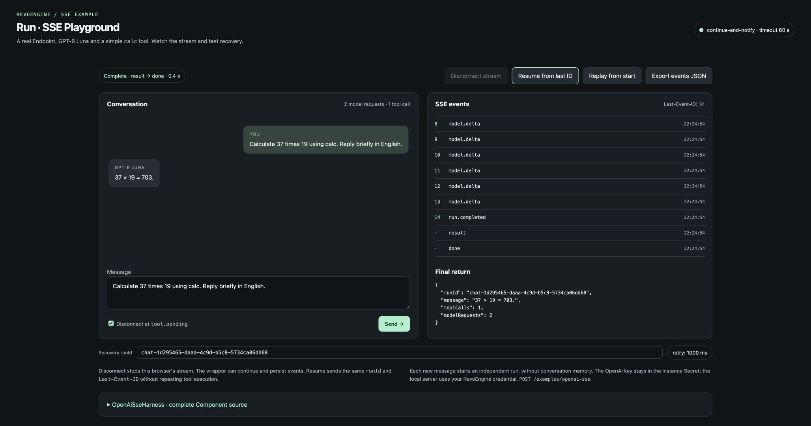
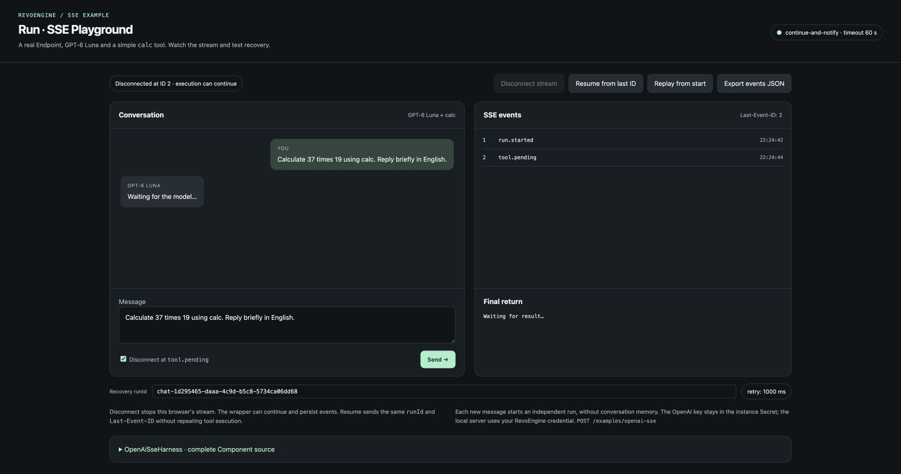
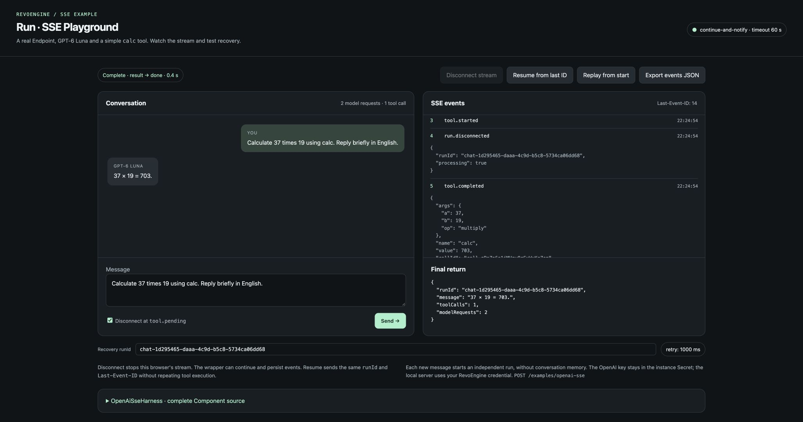

import { ScreenshotDetail } from "/snippets/screenshot-detail.jsx";

This is the complete browser application used to test the
[OpenAI tools Component](/operate/sse-openai-example). It sends a real POST to the
Endpoint runtime, displays generated text and keeps authored SSE events separate
from the final return. The screenshots below were captured from that application
using the same Component source shown in the tutorial.

The client is plain HTML, CSS and JavaScript. A small local Node.js server serves
the files and forwards one fixed Endpoint route. The RevoEngine credential stays
in that server's environment; the OpenAI credential stays in the instance Secret.
This developer demo has no build step and no package dependency. Use Node.js 24.

<span id="complete-application-code" aria-hidden="true"></span>

<CardGroup cols={2}>
  <Card title="Browser application source" href="/examples/sse/browser-source" icon="book-open">Complete HTML, client, parser and proxy for the SSE example.</Card>
</CardGroup>


## See the actual result

The example prompt asks the model to calculate `37 × 19` with `calc`. The application
shows the generated answer, the selected Component return and transport completion.
The run below used **one tool execution and two model requests** and returned `703`.

<Frame caption="The HTML client calling the real SSE Endpoint: model text, persisted event IDs, final result and done are visible separately.">
  
</Frame>

<ScreenshotDetail src="/images/endpoints/html-chat-completed.jpg" alt="HTML SSE chat displaying 37 times 19 equals 703, one tool call, two model requests, and result followed by done" width={2056} height={1082} />

**Send** starts a new message; **Resume from last ID** reconnects;
**Replay from start** replays the journal.
Each new message creates a new run ID. It is a one-message tool loop, without
multi-turn conversation memory.

## Download and start

1. Complete the [Component, Secret, Databases and Endpoint setup](/operate/sse-openai-example#prepare-the-instance).
2. [Download the complete browser example](/examples/sse/browser-chat.zip) and extract it into an empty folder.
3. Supply your own RevoEngine credential and actual Endpoint runtime URL in the environment.
4. Run `node server.mjs`, then open `http://localhost:4318` in a browser.

```bash
export REVO_ENDPOINT_URL="https://example.com/examples/openai-sse"
export REVO_AUTHORIZATION="Bearer $REVO_API_KEY"
node server.mjs
```

`REVO_API_KEY` above is your own shell variable. Follow
[Authentication](/developers/authentication) to obtain the appropriate credential.
Set `REVO_INSTANCE` only when your environment requires an instance-routing header.
Set `DEMO_PORT` to change the local client port. An optional `--open` flag opens
Chrome on macOS. The local proxy deadline is 70 seconds for the sample's 60-second
Endpoint execution budget; align both if you change the Endpoint timeout.

The archive contains the full files shown below plus `component.txt`, which is the
exact Component body from the [backend tutorial](/examples/sse/component-source#complete-component-source).
It contains no credentials or environment file.

| File | Responsibility | Individual download |
| --- | --- | --- |
| `index.html` | Layout, styles, chat input, event list and source disclosure. | [HTML](/examples/sse/browser-chat/index.html.txt) |
| `chat.mjs` | POST stream lifecycle, UI, cursor, disconnect, recovery and export. | [Client code](/examples/sse/browser-chat/chat.mjs.txt) |
| `sse-parser.mjs` | Incremental SSE framing across arbitrary network chunks. | [Parser](/examples/sse/browser-chat/sse-parser.mjs.txt) |
| `server.mjs` | Local static server and streaming proxy to the configured Endpoint. | [Server](/examples/sse/browser-chat/server.mjs.txt) |
| `component.txt` | Backend Component body, shown by the client's source panel. | [Component](/examples/sse/openai-component.txt) |

Individual source downloads use plain text; save them under the file names in the
first column. The archive already uses the correct executable file names.

## Reproduce disconnect and recovery

1. Check **Disconnect at tool.pending** and send the calculation prompt.
2. The client aborts its fetch after receiving the actual `tool.pending` event. Record
   its displayed last event ID; this sample run stopped at ID `2`.
3. The local proxy also closes that request's upstream connection. The Endpoint's
   `continue-and-notify` policy lets the producer continue and persist its callback.
4. Click **Resume from last ID**. The client sends the same run ID and
   `Last-Event-ID`, then consumes only later application events.
5. Inspect `run.disconnected`, the tool output, the final answer and `result → done`.

<Frame caption="The first client stopped after tool.pending at ID 2. The UI has not received a final answer; the Endpoint is allowed to continue within its original timeout.">
  
</Frame>

<ScreenshotDetail src="/images/endpoints/html-chat-disconnected.jpg" alt="HTML SSE chat disconnected at event ID 2 with a pending tool and the resume button available" width={2056} height={1082} />

<Frame caption="Recovery from the saved cursor includes run.disconnected and the persisted calc result. The original run completes without starting another producer.">
  
</Frame>

<ScreenshotDetail src="/images/endpoints/html-chat-recovery.jpg" alt="Recovered HTML chat showing the disconnect notification, calc arguments and value 703, with one tool call and two model requests" width={2056} height={1082} />

To read the result again, click **Resume from last ID** after completion. To see every stored event,
click **Replay from start**. Both requests observe the saved run. Neither repeats
its model or tool work. The automatic test checkbox affects a newly sent message;
it does not interrupt a replay.

The client keeps only its last run ID, message and cursor in browser storage, so a
reload can reconnect. It does not store either credential there. The JSON export
contains the selected run and received frames; treat prompt and generated content
according to your application's data policy.

## Client lifecycle and deployment boundary

The client decodes UTF-8 incrementally and parses SSE lines independently from
network chunks, including CRLF boundaries and multiline `data`. It distinguishes
ordinary HTTP rejection, an SSE error and a connection ending without `done`.
A clean EOF alone is not treated as success. Event payloads are rendered as text.
The server preserves backpressure and propagates browser abort to the upstream
request; it does not buffer a complete response before forwarding it.

`retry` is displayed as a reconnection hint. Reconnect is an explicit button action
in this example, not an automatic retry loop. The client deduplicates authored
numeric sequence IDs when observing this particular journal. A general SSE client
must also support applications using other string IDs.

The local proxy intentionally uses one developer's RevoEngine credential and binds
to localhost. For a deployed multi-user application, integrate your own sign-in,
resolve caller authorization per request and preserve run ownership. Do not expose
one shared developer credential as an application-wide production identity.

This application demonstrates the Endpoint contract; it does not add durable worker
execution, exactly-once business effects or automatic server replay. Those boundaries
remain in the [Component's recovery design](/operate/sse-openai-example#boundaries-to-keep-in-a-production-integration).
