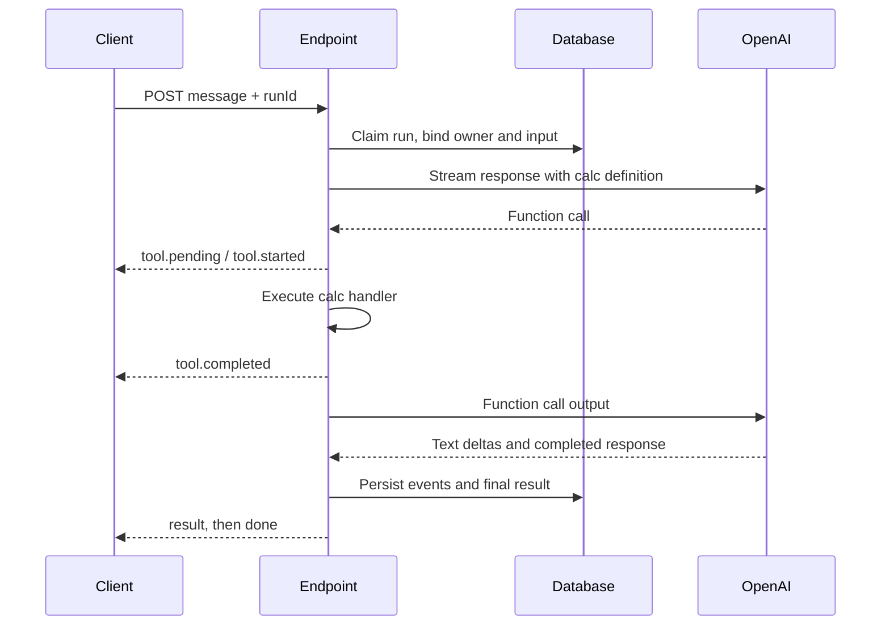
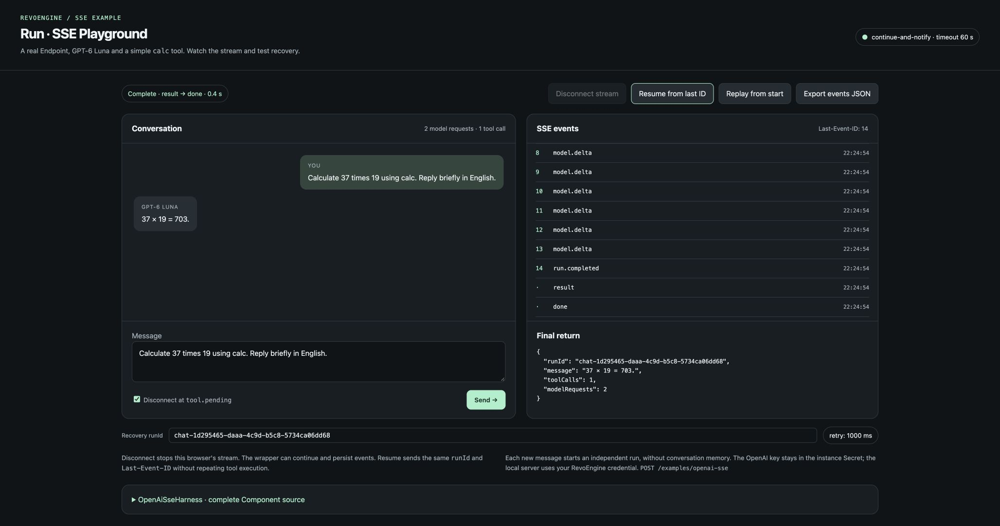
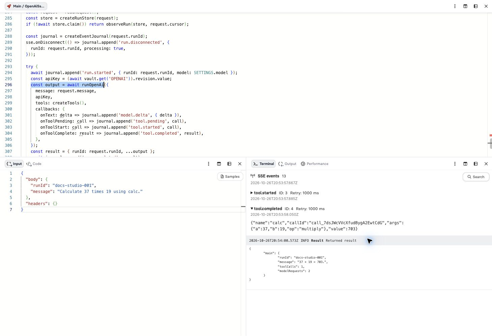

This example exposes a small OpenAI tool loop through a RevoEngine SSE Endpoint.
A user asks for a calculation, the model requests `calc`, the Component executes it
and streams the final answer. Reconnecting with the same run ID observes the saved
operation instead of calling the model or calculator again.

The sample is a single JavaScript Component with no external package dependency.
The model loop accepts tool handlers and callbacks; persistence and SSE framing stay
outside that loop. It is a readable starting point for a production integration,
with the recovery boundaries below made explicit.



Every application event is persisted before it is sent, including text deltas and
notification of a detected disconnect. The sequence diagram condenses those writes.

<span id="complete-component-source" aria-hidden="true"></span>

<CardGroup cols={2}>
  <Card title="SSE Component source" href="/examples/sse/component-source" icon="book-open">Complete downloadable source for the streamed tool-calling example.</Card>
</CardGroup>


## Try the complete browser application

The [HTML chat example](/operate/sse-browser-client) includes the full client,
incremental SSE parser and local streaming proxy, with no omitted helper functions.
Download its ready-to-run archive, configure your own RevoEngine credential and
point it at this Endpoint. The OpenAI key stays in the instance Secret.

<Frame caption="The documented Component behind the HTML chat: one calculation, streamed events, a final return and result/done completion.">
  
</Frame>

See the client's [disconnect and recovery screenshots](/operate/sse-browser-client#reproduce-disconnect-and-recovery)
for the same run, and [all four application files](/examples/sse/browser-source#complete-application-code)
for the exact browser/proxy implementation. The complete backend source is visible
below, including its journal and tool callbacks.

## Prepare the instance

<Steps>
  <Step title="Create the Secret">
    Create an enabled instance Secret named `OPENAI` containing an OpenAI API key.
    The Component reads it with `vault.get('OPENAI')`. Keep that key on the server.
    The client authenticates to RevoEngine with its own credentials.
  </Step>
  <Step title="Create the two Databases">
    Use the fields below and grant the execution account the necessary data access.
    `runId` and `eventId` are unique primary keys. Keep these Databases private to
    trusted application execution; the ownership check in the Component does not
    replace Database ACLs.
  </Step>
  <Step title="Save the Component">
    Create a JavaScript Component named `OpenAiSseHarness`, with one visible element
    named `Main`. Paste the complete source below. Save and activate its runtime
    through the normal Studio workflow.
  </Step>
  <Step title="Configure the Endpoint">
    Bind the Component to `POST /examples/openai-sse`. Select SSE, output `Main`,
    timeout 60 seconds and **Continue and notify**. Keep the default terminal names.
    Use caller business identity for per-user run ownership. Select an execution
    authority that can read the Secret and access the two Databases.
  </Step>
</Steps>

### Database fields

| Database | Fields |
| --- | --- |
| `SseAiRuns` | `runId`: TEXT, primary/unique; `owner`: TEXT; `message`: TEXT; `status`: TEXT; `final`: JSONB, nullable. |
| `SseAiEvents` | `eventId`: TEXT, primary/unique; `runId`: TEXT, indexed; `seq`: INTEGER; `event`: TEXT; `payload`: JSONB. |

All fields except `final` are required. The primary key `eventId` is constructed as
`runId:sequence`. Give production event history an appropriate retention policy.

### Endpoint options and guard

Use the standard [Endpoint configuration](/operate/endpoint-configuration) for the
route, Component and execution authority. The relevant options are:

```json
{
  "timeout": 60,
  "options": {
    "responseMode": "sse",
    "popResult": "Main",
    "hideRequest": true,
    "hideResponse": true,
    "sse": {
      "disconnect": "continue-and-notify",
      "resultEvent": "result",
      "errorEvent": "error",
      "doneEvent": "done"
    }
  }
}
```

Validate the structured request before starting the stream. This RevoEngine guard
requires a run ID, bounds the optional message and preserves the cursor header:

```json
{
  "profile": "strict",
  "additionalProperties": "allow",
  "schema": {
    "type": "object",
    "required": true,
    "objectSchema": [
      {
        "property": "body",
        "schema": {
          "type": "object",
          "required": true,
          "objectSchema": [
            { "property": "runId", "schema": { "type": "string", "required": true, "min": 1, "max": 80 } },
            { "property": "message", "schema": { "type": "string", "min": 1, "max": 2000 } },
            { "property": "after", "schema": { "type": "number", "integer": true, "min": 0 } }
          ]
        }
      }
    ]
  }
}
```

The Component additionally validates the run ID format and cursor, requires a
message for a new run and rejects an existing run with another owner or input.
The tool's `parameters` uses OpenAI JSON Schema; the Endpoint guard above uses
RevoEngine [ValidatorSchema](/low-code/json-validator).

## Read the orchestration first

The main flow keeps model callbacks separate from persistence:

```js title="Callback wiring · excerpt"
const output = await runOpenAi({
  message: request.message,
  apiKey,
  tools: createTools(),
  callbacks: {
    onText: (delta) => journal.append('model.delta', { delta }),
    onToolPending: (call) => journal.append('tool.pending', call),
    onToolStart: (call) => journal.append('tool.started', call),
    onToolComplete: (result) =>
      journal.append('tool.completed', result),
  },
});
```

`createTools()` maps each public function definition to an asynchronous `execute`
handler. To add another tool, add a registry entry with its schema and handler;
the model loop and SSE callbacks do not need another name-specific branch.
Validate arguments again in the handler, even with a strict tool schema. Put
resource authorization and idempotency inside a handler that performs business
mutations. Never use `eval` to implement a calculator or dispatch a tool by arbitrary
user-supplied code.

The sample uses [OpenAI Responses function calling](https://developers.openai.com/api/docs/guides/function-calling)
and the public [`gpt-6-luna` model](https://developers.openai.com/api/docs/models/gpt-6-luna)
with reasoning disabled. It preserves the model output alongside each
`function_call_output`, awaits callbacks, limits model/tool calls, caps output tokens
and closes every opened upstream stream in `finally`. It does not retry an upstream
request automatically.

## Invoke and inspect the stream

Use a new run ID for each new message:

```bash
curl --no-buffer "$REVO_ENDPOINT_URL/examples/openai-sse" \
  --request POST \
  --header "Authorization: Bearer $REVO_API_KEY" \
  --header "Content-Type: application/json" \
  --data '{"runId":"example-1","message":"Calculate 37 times 19 using calc."}'
```

A typical sequence is:

| Event | Payload |
| --- | --- |
| `run.started` | Run ID and selected model. |
| `tool.pending` | Tool name and provider call ID. Arguments are not complete yet. |
| `tool.started` | Dispatch context: name, call ID and parsed arguments. The handler validates their values. |
| `tool.completed` | Dispatch context and the calculated `value`, here `703`. |
| `model.delta` | A piece of the generated answer. |
| `run.completed` | The final application result persisted for replay. |
| `result` | The return value selected from `Main`. |
| `done` | `{ "error": false }`. |

The model decides whether a tool is needed. Arithmetic prompts normally produce a
calculation; a greeting may produce text without a tool call. Text, delta count and
number of model requests can vary. For `37 × 19`, inspect that the actual tool value
is `703`, rather than matching the exact wording of the answer.

```json title="Example final return"
{
  "runId": "example-1",
  "message": "37 × 19 = 703.",
  "toolCalls": 1,
  "modelRequests": 2
}
```

`run.completed` is an application event stored in the journal. `result` and `done`
are automatic transport frames. Returning the final result does not manually emit
those reserved names.

## Disconnect and recover

The Endpoint uses `continue-and-notify`. The producer registers one callback that
appends `run.disconnected` to the same serialized journal as the main flow. Further
socket writes are discarded after disconnect, while database writes and model/tool
work can continue within the original 60-second deadline.

Stop the first client after `tool.pending`. Reconnect using the same run ID and the
last event ID you actually processed:

```bash
curl --no-buffer "$REVO_ENDPOINT_URL/examples/openai-sse" \
  --request POST \
  --header "Authorization: Bearer $REVO_API_KEY" \
  --header "Content-Type: application/json" \
  --header "Last-Event-ID: 2" \
  --data '{"runId":"example-1"}'
```

`2` is an example cursor; use the ID received from your own stream. The header takes
precedence over optional `body.after`. The observer verifies the stored owner before
reading any events, drains them in ascending sequence and returns the saved result.
A completed reread after the final cursor returns that result with no repeated model
or tool execution. To replay the full journal, use cursor `0`.

This is application recovery, not automatic SSE replay. Producer ownership is
claimed before contacting OpenAI, and the stored run remains authoritative after
the claim's retention expires. Never delete an incomplete run and retry its
mutations without first reconciling their outcome.

## Model and tool diagnostics

The Component writes diagnostic `api.log` entries separately from its application
SSE events. The logs show the request number, observed OpenAI lifecycle events,
requested tool name and call ID, arguments passed to the tool, its returned result,
and a completed-response summary. Text deltas remain in the SSE journal; the logs
summarize their character count instead of repeating every token.

These are observable API decisions, not the model's private reasoning. The tool
request and arguments show what the model asked the harness to execute. The sample
does not fabricate a reason or request hidden chain of thought. Logs never include
authorization headers, the API key or an entire provider request/response.
Recovery logs identify the retained run and cursor; reconnecting does not issue
another OpenAI request or replay a tool effect. Diagnostic logs themselves are not
replayed by the application journal.

## Debug in Studio

Select the Component as the debugger target, switch from restricted mode to
**Full execution**, set a 60-second timeout and choose **Continue and notify**.
Restricted mode rejects the idempotency claim and persistence writes; it cannot run
this producer. The debugger input wraps the client body in the normal request context:

```json
{
  "body": { "runId": "debug-example-1", "message": "Calculate 37 times 19 using calc." },
  "headers": {}
}
```

For a recovery debug call, use the same run ID, omit `message` if desired and set
`headers["last-event-id"]` to the cursor string. Inspect **SSE events** separately
from logs and the final result.

<Frame caption="The sample running in Studio: emitted events and final results are separate debugger views.">
  
</Frame>

Then repeat the test through the actual Endpoint runtime. Debugger transport and
runtime response framing are different boundaries; one does not substitute for the
other. Use a new run ID to make another real model request.

## Boundaries to keep in a production integration

- **Transient work:** process loss or a hard timeout can leave a run marked `running`.
  A reconnect observes it; it cannot restart lost execution memory. Add a durable Job
  or explicit reconciliation when that work must finish reliably.
- **Idempotency:** the producer claim prevents duplicate starts through this sample
  path. It does not make an arbitrary external tool side effect exactly once across
  a crash. Give each mutating tool a provider-supported idempotency key and durable
  outcome tracking.
- **Privacy:** the Component suppresses raw provider errors and never persists its
  API key. The journal deliberately stores the prompt, tool arguments, results and
  generated text. Apply access controls, redaction and retention to that data.
  `hideRequest` and `hideResponse` affect execution history, not these explicit writes.
- **Resource limits:** observers use bounded pages but poll for pending work. Align
  concurrent observers, event retention and run duration with instance capacity. For
  a larger deployment, batch adjacent text deltas before persisting each event.
- **Conversation:** each run is one user message and its tool loop. Add authorized
  conversation state explicitly if you need multi-turn chat; do not trust a caller's
  arbitrary history as privileged instructions.
- **Notification:** `onDisconnect` is best effort and shares the execution deadline.
  The main flow and callback may overlap; the journal orders writes. A disconnect
  notification can arrive late, and is not a durable business finalizer.

Continue with [SSE lifecycle and custom framing](/operate/endpoint-sse),
[Endpoint security and configuration](/operate/endpoint-configuration) and
[durable Jobs](/operate/jobs).
