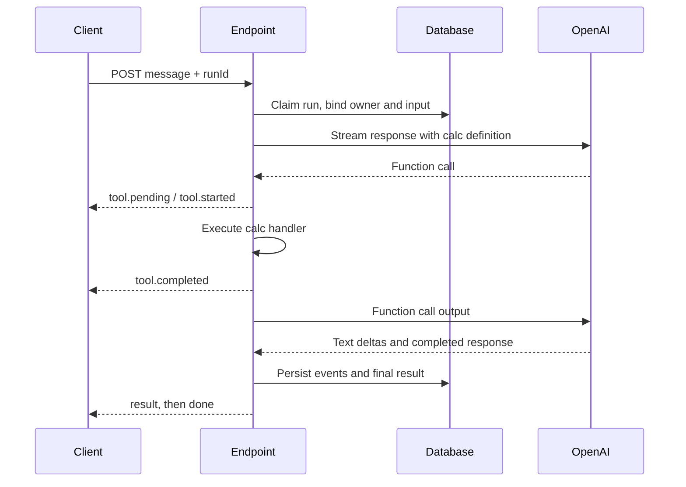

<Note>These features require Platform 1.7.0 on the target instance. Publishing this documentation or updating the CLI does not upgrade the application.</Note>

This example exposes a small OpenAI tool loop through a RevoEngine SSE Endpoint.
A user asks for a calculation, the model requests `calc`, the Component executes it
and streams the final answer. Reconnecting with the same run ID observes the saved
operation instead of calling the model or calculator again.

The sample is a single JavaScript Component with no external package dependency.
The model loop accepts tool handlers and callbacks; persistence and SSE framing stay
outside that loop. It is a readable starting point for a production integration,
with the recovery boundaries below made explicit.



Every application event is persisted before it is sent, including text deltas and
notification of a detected disconnect. The sequence diagram condenses those writes.

## Try the complete browser application

The [HTML chat example](/operate/sse-browser-client) includes the full client,
incremental SSE parser and local streaming proxy, with no omitted helper functions.
Download its ready-to-run archive, configure your own RevoEngine credential and
point it at this Endpoint. The OpenAI key stays in the instance Secret.

<Frame caption="The documented Component behind the HTML chat: one calculation, streamed events, a final return and result/done completion.">
  
</Frame>

See the client's [disconnect and recovery screenshots](/operate/sse-browser-client#reproduce-disconnect-and-recovery)
for the same run, and [all four application files](/operate/sse-browser-client#complete-application-code)
for the exact browser/proxy implementation. The complete backend source is visible
below, including its journal and tool callbacks.

## Prepare the instance

<Steps>
  <Step title="Create the Secret">
    Create an enabled instance Secret named `OPENAI` containing an OpenAI API key.
    The Component reads it with `vault.get('OPENAI')`. Keep that key on the server.
    The client authenticates to RevoEngine with its own credentials.
  </Step>
  <Step title="Create the two Databases">
    Use the fields below and grant the execution account the necessary data access.
    `runId` and `eventId` are unique primary keys. Keep these Databases private to
    trusted application execution; the ownership check in the Component does not
    replace Database ACLs.
  </Step>
  <Step title="Save the Component">
    Create a JavaScript Component named `OpenAiSseHarness`, with one visible element
    named `Main`. Paste the complete source below. Save and activate its runtime
    through the normal Studio workflow.
  </Step>
  <Step title="Configure the Endpoint">
    Bind the Component to `POST /examples/openai-sse`. Select SSE, output `Main`,
    timeout 60 seconds and **Continue and notify**. Keep the default terminal names.
    Use caller business identity for per-user run ownership. Select an execution
    authority that can read the Secret and access the two Databases.
  </Step>
</Steps>

### Database fields

| Database | Fields |
| --- | --- |
| `SseAiRuns` | `runId`: TEXT, primary/unique; `owner`: TEXT; `message`: TEXT; `status`: TEXT; `final`: JSONB, nullable. |
| `SseAiEvents` | `eventId`: TEXT, primary/unique; `runId`: TEXT, indexed; `seq`: INTEGER; `event`: TEXT; `payload`: JSONB. |

All fields except `final` are required. The primary key `eventId` is constructed as
`runId:sequence`. Give production event history an appropriate retention policy.

### Endpoint options and guard

Use the standard [Endpoint configuration](/operate/endpoint-configuration) for the
route, Component and execution authority. The relevant options are:

```json
{
  "timeout": 60,
  "options": {
    "responseMode": "sse",
    "popResult": "Main",
    "hideRequest": true,
    "hideResponse": true,
    "sse": {
      "disconnect": "continue-and-notify",
      "resultEvent": "result",
      "errorEvent": "error",
      "doneEvent": "done"
    }
  }
}
```

Validate the structured request before starting the stream. This RevoEngine guard
requires a run ID, bounds the optional message and preserves the cursor header:

```json
{
  "profile": "strict",
  "additionalProperties": "allow",
  "schema": {
    "type": "object",
    "required": true,
    "objectSchema": [
      {
        "property": "body",
        "schema": {
          "type": "object",
          "required": true,
          "objectSchema": [
            { "property": "runId", "schema": { "type": "string", "required": true, "min": 1, "max": 80 } },
            { "property": "message", "schema": { "type": "string", "min": 1, "max": 2000 } },
            { "property": "after", "schema": { "type": "number", "integer": true, "min": 0 } }
          ]
        }
      }
    ]
  }
}
```

The Component additionally validates the run ID format and cursor, requires a
message for a new run and rejects an existing run with another owner or input.
The tool's `parameters` uses OpenAI JSON Schema; the Endpoint guard above uses
RevoEngine [ValidatorSchema](/low-code/json-validator).

## Read the orchestration first

The main flow keeps model callbacks separate from persistence:

```js title="Callback wiring · excerpt"
const output = await runOpenAi({
  message: request.message,
  apiKey,
  tools: createTools(),
  callbacks: {
    onText: delta => journal.append('model.delta', { delta }),
    onToolPending: call => journal.append('tool.pending', call),
    onToolStart: call => journal.append('tool.started', call),
    onToolComplete: result => journal.append('tool.completed', result),
  },
});
```

`createTools()` maps each public function definition to an asynchronous `execute`
handler. To add another tool, add a registry entry with its schema and handler;
the model loop and SSE callbacks do not need another name-specific branch.
Validate arguments again in the handler, even with a strict tool schema. Put
resource authorization and idempotency inside a handler that performs business
mutations. Never use `eval` to implement a calculator or dispatch a tool by arbitrary
user-supplied code.

The sample uses [OpenAI Responses function calling](https://developers.openai.com/api/docs/guides/function-calling)
and the public [`gpt-6-luna` model](https://developers.openai.com/api/docs/models/gpt-6-luna)
with reasoning disabled. It preserves the model output alongside each
`function_call_output`, awaits callbacks, limits model/tool calls, caps output tokens
and closes every opened upstream stream in `finally`. It does not retry an upstream
request automatically.

## Complete Component source

[Download the Component body as plain text](/examples/sse/openai-component.txt), or copy it below into
`Main`. This is an element body; it has no imports or module exports.

```js title="Component · Main"
/**
 * Main element of a CODE_JS Component.
 * Endpoint: POST /examples/openai-sse, popResult: Main.
 * SSE disconnect policy: continue-and-notify. Original timeout: 60 seconds.
 * Input: { body: { runId: 'example-1', message: 'Calculate 37 * 19.' } }
 */
const SETTINGS = Object.freeze({
  model: 'gpt-6-luna',
  maxModelRequests: 3,
  maxToolCalls: 3,
  maxOutputTokens: 1200,
  reserveMs: 500,
  pollMs: 100,
  pageSize: 100,
  retryMs: 1000,
  claimTtlSeconds: 86400,
});

class SampleError extends Error {
  constructor(code, message) {
    super(message);
    this.code = code;
  }
}

function readRequest() {
  const input = api.input();
  const body = input.body ?? input;
  const cursor = Number(input.headers?.['last-event-id'] ?? body.after ?? 0);

  if (typeof body.runId !== 'string' || !/^[a-zA-Z0-9_-]{1,80}$/.test(body.runId)) {
    throw new SampleError('INVALID_RUN_ID', 'Use 1–80 letters, digits, underscores or hyphens for runId.');
  }
  if (!Number.isSafeInteger(cursor) || cursor < 0) {
    throw new SampleError('INVALID_CURSOR', 'Last-Event-ID must be a nonnegative safe integer.');
  }
  if (body.message !== undefined && (typeof body.message !== 'string'
    || !body.message.trim() || body.message.length > 2000)) {
    throw new SampleError('INVALID_MESSAGE', 'Provide a message of 1–2000 characters.');
  }

  return { runId: body.runId, message: body.message, cursor, owner: api.currentUser().userId };
}

function createRunStore(request) {
  const { runId, owner, message } = request;
  const filter = { field: 'runId', op: 'eq', value: runId };

  return {
    async read() {
      const run = await api.getDatabaseDataRow('SseAiRuns', { filter });
      if (run && run.owner !== owner) {
        throw new SampleError('RUN_ACCESS_DENIED', 'This run belongs to another user.');
      }
      if (run && message !== undefined && run.message !== message) {
        throw new SampleError('RUN_CONFLICT', 'This runId already belongs to a different message.');
      }
      return run;
    },
    async claim() {
      if (await this.read()) return false;
      if (message === undefined) {
        throw new SampleError('MESSAGE_REQUIRED', 'A message is required to start a new run.');
      }
      const acquired = await api.acquireIdempotencyKey(
        'sse-ai-harness:' + runId, SETTINGS.claimTtlSeconds, { owner },
      );
      if (acquired) {
        await api.insertDatabaseData('SseAiRuns', [{ runId, owner, message, status: 'running', final: null }]);
      }
      return acquired;
    },
    async complete(result) {
      await api.updateDatabaseData('SseAiRuns', { runId }, { status: 'completed', final: result });
    },
    async fail() {
      await api.updateDatabaseData('SseAiRuns', { runId }, { status: 'failed' });
    },
    async eventsAfter(cursor) {
      const page = await api.getDatabaseData('SseAiEvents', {
        filter: { and: [filter, { field: 'seq', op: 'gt', value: cursor }] },
        sort: ['seq'],
        take: SETTINGS.pageSize,
      });
      return page.data ?? [];
    },
  };
}

function createEventJournal(runId) {
  let sequence = 0;
  let tail = Promise.resolve();

  return {
    append(event, payload) {
      // The main flow and disconnect callback share one ordered write queue.
      const next = tail.then(async () => {
        const seq = ++sequence;
        await api.insertDatabaseData('SseAiEvents', [{
          eventId: runId + ':' + seq, runId, seq, event, payload,
        }]);
        await sse.json(payload, { event, id: String(seq), retry: SETTINGS.retryMs });
      });
      tail = next;
      // Observe rejection without turning a failed persistence chain into success.
      void next.catch(() => {});
      return next;
    },
    flush() { return tail; },
  };
}

async function observeRun(store, initialCursor) {
  let cursor = initialCursor;
  while (sse.remainingTime() > SETTINGS.reserveMs) {
    const run = await store.read();
    // Do not expose events until the stored run has passed its ownership check.
    if (!run) {
      await util.sleep(SETTINGS.pollMs);
      continue;
    }
    const rows = await store.eventsAfter(cursor);
    for (const row of rows) {
      await sse.json(row.payload, { event: row.event, id: String(row.seq), retry: SETTINGS.retryMs });
      cursor = row.seq;
    }
    if (rows.length === SETTINGS.pageSize) continue;
    if (run.status === 'completed') return run.final;
    if (run.status === 'failed') {
      throw new SampleError('ORIGINAL_RUN_FAILED', 'The original run failed. Inspect its retained events.');
    }
    await util.sleep(SETTINGS.pollMs);
  }
  throw new SampleError('RECOVERY_PENDING', 'The original run is still pending. Reconnect with the last event ID.');
}

function createTools() {
  return new Map([
    ['calc', {
      definition: {
        type: 'function',
        name: 'calc',
        description: 'Calculate using two numbers and an arithmetic operation.',
        strict: true,
        parameters: {
          type: 'object',
          properties: {
            a: { type: 'number' },
            b: { type: 'number' },
            op: { type: 'string', enum: ['add', 'subtract', 'multiply', 'divide'] },
          },
          required: ['a', 'b', 'op'],
          additionalProperties: false,
        },
      },
      async execute(args) {
        const operations = {
          add: (a, b) => a + b,
          subtract: (a, b) => a - b,
          multiply: (a, b) => a * b,
          divide: (a, b) => a / b,
        };
        if (!args || !Object.hasOwn(operations, args.op)
          || !Number.isFinite(args.a) || !Number.isFinite(args.b)
          || Math.abs(args.a) > 1e9 || Math.abs(args.b) > 1e9) {
          throw new SampleError('INVALID_TOOL_ARGUMENTS', 'calc requires two bounded finite numbers and a supported operation.');
        }
        if (args.op === 'divide' && args.b === 0) {
          throw new SampleError('DIVISION_BY_ZERO', 'Division by zero is not allowed.');
        }
        const value = operations[args.op](args.a, args.b);
        if (!Number.isFinite(value)) {
          throw new SampleError('INVALID_TOOL_RESULT', 'The calculation must produce a finite number.');
        }
        return { value };
      },
    }],
  ]);
}

async function requestModel({ apiKey, input, tools, finalRound, callbacks }) {
  const timeout = Math.floor(sse.remainingTime() - SETTINGS.reserveMs);
  if (timeout <= 0) throw new SampleError('DEADLINE_REACHED', 'The execution deadline is approaching.');

  let response;
  try {
    response = await api.httpCall({
      url: 'https://api.openai.com/v1/responses',
      method: 'POST',
      headers: { Authorization: `Bearer ${apiKey}`, 'Content-Type': 'application/json' },
      data: {
        model: SETTINGS.model,
        reasoning: { effort: 'none' },
        store: false,
        stream: true,
        max_output_tokens: SETTINGS.maxOutputTokens,
        instructions: 'Use calc for arithmetic. Reply briefly in the language of the user.',
        input,
        tools: [...tools.values()].map(tool => tool.definition),
        tool_choice: finalRound ? 'none' : 'auto',
        parallel_tool_calls: false,
      },
    }, { responseType: 'stream', streamFormat: 'sse', timeout });
  } catch {
    throw new SampleError('MODEL_UNAVAILABLE', 'The model connection could not be opened.');
  }

  try {
    if (response.status !== 200) {
      throw new SampleError('MODEL_HTTP_ERROR', 'The model provider rejected the request.');
    }
    let completed;
    for await (const frame of response.data) {
      if (!frame.data || frame.data === '[DONE]') continue;
      const event = JSON.parse(frame.data);
      if (event.type === 'response.output_text.delta') {
        await callbacks.onText(event.delta);
      }
      if (event.type === 'response.output_item.added' && event.item?.type === 'function_call') {
        await callbacks.onToolPending({ name: event.item.name, callId: event.item.call_id });
      }
      if (event.type === 'response.completed') completed = event.response;
      if (['error', 'response.failed', 'response.incomplete'].includes(event.type)) {
        throw new SampleError('MODEL_FAILED', 'The model response did not complete.');
      }
    }
    if (!completed || completed.status !== 'completed' || !Array.isArray(completed.output)) {
      throw new SampleError('MODEL_STREAM_INTERRUPTED', 'The model stream ended without a completed response.');
    }
    return completed;
  } finally {
    await response.close();
  }
}

async function runOpenAi({ message, apiKey, tools, callbacks }) {
  const input = [{ role: 'user', content: message }];
  const executedCalls = new Set();
  let toolCalls = 0;

  for (let request = 1; request <= SETTINGS.maxModelRequests; request++) {
    const response = await requestModel({
      apiKey, input, tools, callbacks, finalRound: request === SETTINGS.maxModelRequests,
    });
    // Preserve the model's complete output when returning function_call_output.
    input.push(...response.output);
    const calls = response.output.filter(item => item.type === 'function_call');
    if (!calls.length) {
      const message = response.output
        .filter(item => item.type === 'message')
        .flatMap(item => item.content ?? [])
        .filter(part => part.type === 'output_text')
        .map(part => part.text)
        .join('');
      if (!message.trim()) {
        throw new SampleError('MODEL_EMPTY_RESPONSE', 'The model completed without a text answer.');
      }
      return { message, toolCalls, modelRequests: request };
    }
    if (request === SETTINGS.maxModelRequests) {
      throw new SampleError('MODEL_LIMIT_REACHED', 'The model did not produce a final response within the request limit.');
    }
    for (const call of calls) {
      const tool = tools.get(call.name);
      if (!tool || !call.call_id || executedCalls.has(call.call_id)) {
        throw new SampleError('UNSUPPORTED_TOOL_CALL', 'The model requested an unsupported or duplicate tool call.');
      }
      if (toolCalls >= SETTINGS.maxToolCalls) {
        throw new SampleError('TOOL_LIMIT_REACHED', 'The tool execution limit was reached.');
      }
      const args = JSON.parse(call.arguments);
      const context = { name: call.name, callId: call.call_id, args };
      await callbacks.onToolStart(context);
      executedCalls.add(call.call_id);
      const output = await tool.execute(args);
      toolCalls++;
      await callbacks.onToolComplete({ ...context, ...output });
      input.push({ type: 'function_call_output', call_id: call.call_id, output: JSON.stringify(output) });
    }
  }
}

async function main() {
  const request = readRequest();
  const store = createRunStore(request);
  if (!await store.claim()) return observeRun(store, request.cursor);

  const journal = createEventJournal(request.runId);
  sse.onDisconnect(() => journal.append('run.disconnected', {
    runId: request.runId, processing: true,
  }));

  try {
    await journal.append('run.started', { runId: request.runId, model: SETTINGS.model });
    const apiKey = (await vault.get('OPENAI')).revision.value;
    const output = await runOpenAi({
      message: request.message,
      apiKey,
      tools: createTools(),
      callbacks: {
        onText: delta => journal.append('model.delta', { delta }),
        onToolPending: call => journal.append('tool.pending', call),
        onToolStart: call => journal.append('tool.started', call),
        onToolComplete: result => journal.append('tool.completed', result),
      },
    });
    const result = { runId: request.runId, ...output };
    await journal.append('run.completed', result);
    await store.complete(result);
    await journal.flush();
    return result; // Run emits result, then done. Do not emit them manually.
  } catch (error) {
    const failure = error instanceof SampleError
      ? { code: error.code, message: error.message }
      : { code: 'HARNESS_FAILED', message: 'The run failed. Provider details and credentials are omitted.' };
    try { await journal.append('run.failed', { runId: request.runId, ...failure }); }
    catch { console.warn('The failure event could not be persisted.'); }
    try { await store.fail(); }
    catch { console.warn('The failed run state could not be persisted.'); }
    throw new Error(failure.code + ': ' + failure.message);
  }
}

return await main();
```


## Invoke and inspect the stream

Use a new run ID for each new message:

```bash
curl --no-buffer "$REVO_ENDPOINT_URL/examples/openai-sse" \
  --request POST \
  --header "Authorization: Bearer $REVO_API_KEY" \
  --header "Content-Type: application/json" \
  --data '{"runId":"example-1","message":"Calculate 37 times 19 using calc."}'
```

A typical sequence is:

| Event | Payload |
| --- | --- |
| `run.started` | Run ID and selected model. |
| `tool.pending` | Tool name and provider call ID. Arguments are not complete yet. |
| `tool.started` | Dispatch context: name, call ID and parsed arguments. The handler validates their values. |
| `tool.completed` | Dispatch context and the calculated `value`, here `703`. |
| `model.delta` | A piece of the generated answer. |
| `run.completed` | The final application result persisted for replay. |
| `result` | The return value selected from `Main`. |
| `done` | `{ "error": false }`. |

The model decides whether a tool is needed. Arithmetic prompts normally produce a
calculation; a greeting may produce text without a tool call. Text, delta count and
number of model requests can vary. For `37 × 19`, inspect that the actual tool value
is `703`, rather than matching the exact wording of the answer.

```json title="Example final return"
{
  "runId": "example-1",
  "message": "37 × 19 = 703.",
  "toolCalls": 1,
  "modelRequests": 2
}
```

`run.completed` is an application event stored in the journal. `result` and `done`
are automatic transport frames. Returning the final result does not manually emit
those reserved names.

## Disconnect and recover

The Endpoint uses `continue-and-notify`. The producer registers one callback that
appends `run.disconnected` to the same serialized journal as the main flow. Further
socket writes are discarded after disconnect, while database writes and model/tool
work can continue within the original 60-second deadline.

Stop the first client after `tool.pending`. Reconnect using the same run ID and the
last event ID you actually processed:

```bash
curl --no-buffer "$REVO_ENDPOINT_URL/examples/openai-sse" \
  --request POST \
  --header "Authorization: Bearer $REVO_API_KEY" \
  --header "Content-Type: application/json" \
  --header "Last-Event-ID: 2" \
  --data '{"runId":"example-1"}'
```

`2` is an example cursor; use the ID received from your own stream. The header takes
precedence over optional `body.after`. The observer verifies the stored owner before
reading any events, drains them in ascending sequence and returns the saved result.
A completed reread after the final cursor returns that result with no repeated model
or tool execution. To replay the full journal, use cursor `0`.

This is application recovery, not automatic SSE replay. Producer ownership is
claimed before contacting OpenAI, and the stored run remains authoritative after
the claim's retention expires. Never delete an incomplete run and retry its
mutations without first reconciling their outcome.

## Debug in Studio

Select the Component as the debugger target, switch from restricted mode to
**Full execution**, set a 60-second timeout and choose **Continue and notify**.
Restricted mode rejects the idempotency claim and persistence writes; it cannot run
this producer. The debugger input wraps the client body in the normal request context:

```json
{
  "body": { "runId": "debug-example-1", "message": "Calculate 37 times 19 using calc." },
  "headers": {}
}
```

For a recovery debug call, use the same run ID, omit `message` if desired and set
`headers["last-event-id"]` to the cursor string. Inspect **SSE events** separately
from logs and the final result.

<Frame caption="The sample running in Studio: emitted events and final results are separate debugger views.">
  
</Frame>

Then repeat the test through the actual Endpoint runtime. Debugger transport and
runtime response framing are different boundaries; one does not substitute for the
other. Use a new run ID to make another real model request.

## Boundaries to keep in a production integration

- **Transient work:** process loss or a hard timeout can leave a run marked `running`.
  A reconnect observes it; it cannot restart lost execution memory. Add a durable Job
  or explicit reconciliation when that work must finish reliably.
- **Idempotency:** the producer claim prevents duplicate starts through this sample
  path. It does not make an arbitrary external tool side effect exactly once across
  a crash. Give each mutating tool a provider-supported idempotency key and durable
  outcome tracking.
- **Privacy:** the Component suppresses raw provider errors and never persists its
  API key. The journal deliberately stores the prompt, tool arguments, results and
  generated text. Apply access controls, redaction and retention to that data.
  `hideRequest` and `hideResponse` affect execution history, not these explicit writes.
- **Resource limits:** observers use bounded pages but poll for pending work. Align
  concurrent observers, event retention and run duration with instance capacity. For
  a larger deployment, batch adjacent text deltas before persisting each event.
- **Conversation:** each run is one user message and its tool loop. Add authorized
  conversation state explicitly if you need multi-turn chat; do not trust a caller's
  arbitrary history as privileged instructions.
- **Notification:** `onDisconnect` is best effort and shares the execution deadline.
  The main flow and callback may overlap; the journal orders writes. A disconnect
  notification can arrive late, and is not a durable business finalizer.

Continue with [SSE lifecycle and custom framing](/operate/endpoint-sse),
[Endpoint security and configuration](/operate/endpoint-configuration) and
[durable Jobs](/operate/jobs).
