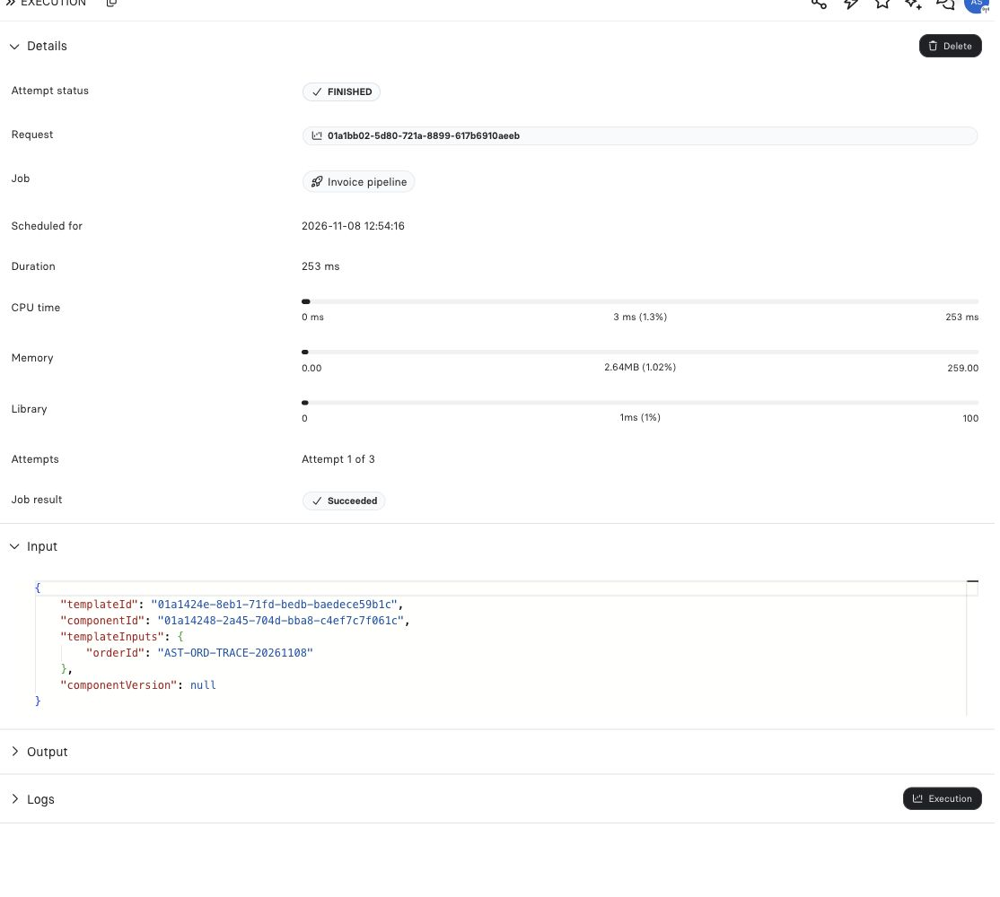

import { ScreenshotDetail } from "/snippets/screenshot-detail.jsx";

import { FlowDemo, PlaygroundStyle, useDemoPlayback, flowCatalog } from "/snippets/revo-playground.jsx";

An execution journey answers a different question from Activity, database audit, and logs: it follows the technical path of one operation across service boundaries. Use it when you need to know where a request spent time, where it failed, or whether asynchronous work was accepted versus completed.

Open **Security Admin → Observability → Executions**. Operation and Execution references from Jobs, Assistant messages, audit records, logs and dashboards open the shared execution dialog without leaving the current page or changing its URL. Press Escape or click outside to return to the caller. Existing Trace URLs redirect to Observability Executions.

## Explore the behavior

<FlowDemo topic="evidence" />

## Start with the right identifier

| Identifier | Best starting question |
| --- | --- |
| Operation ID | Which distributed path did this request, dispatch, or delivery take? |
| Execution ID | Why did this Endpoint or Component execution fail or run slowly? |
| Job ID | What happened to this durable background task and its retry lineage? |
| Event history ID | Which Event targets were resolved, skipped, or executed? |
| Thread/message or Agent/run ID | What did the Assistant or Agent turn do? |

For HTTP endpoint support, capture the UTC timestamp, method/path, response status, and `x-revo-oid` response header. Do not collect the bearer credential or any signed URL.

## Investigation sequence

```text
caller timestamp and outcome
  -> Operation ID in Executions
  -> Execution or Job record
  -> scoped logs and selected component/version
  -> durable result or finalized Storage artifact
```

An accepted asynchronous request only establishes that work was queued or started. Confirm a terminal Job/run state, delivery result, or finalized Storage artifact before concluding that work succeeded.

## Resolve dates before loading logs

An exact identifier is independent of the list's default 24-hour period. Native retained evidence resolves execution dates across up to 90 days; a Job created days before it starts uses its persisted execution timestamps. Missing or long execution windows are disclosed as partial coverage. A source without the native index needs an explicit UTC window.

Choose **Logs for this operation** to inspect bounded log evidence after selecting the journey. Open payloads only for the entries needed to answer the question. Historical summary recovery can provide a journey or usage aggregate without detailed messages; absence of those messages does not prove that an event never happened.

## What to look for

- **Ingress and authorization**: did the request reach the intended active Endpoint under an authorized principal?
- **Route and validation**: was a definition selected and did its guard reject the structured input before execution?
- **Resolution**: which Component version, custom runtime revision, schema Component, library set, and execution policy were selected?
- **Execution**: which segment is slow or failed; did the configured timeout or cancellation boundary apply?
- **Async handoff**: is a queue acceptance followed by a durable processor/Agent/automation result?
- **External work**: did application code record a safe provider correlation ID that lets you verify an ambiguous timeout without replaying it?

## Trace, logs, and history together

| Surface | Use it for | Do not infer |
| --- | --- | --- |
| Executions | Cross-service path, timing, correlation | Business data history or unmasked request bodies. |
| Logs | Structured details emitted by services or application code | Complete distributed ordering without correlation IDs. |
| Activity | Versioned resource changes and author identity | Runtime execution outcome. |
| Database audit | Row changes recorded after audit is enabled | Endpoint route or queue behavior. |
| Job/Event history | Durable automation state and retries | Every cross-service timing segment. |

## Safe support bundle

Provide a narrow time range, IDs, sanitized status/error text, resource name/ID, selected version, and reproducible non-secret input shape. Redact headers, cookies, API keys, Secret values, private prompts, Storage download URLs, and customer payloads unless an approved secure support channel specifically requires them.

<Tip>
Use the [Observability guide](/operate/observability) for the complete operator workflow, then return here when the investigation needs an execution-first view.
</Tip>

## Example: where did this invoice Job come from?

A quote only calculates a price. A separate order command reserves inventory and schedules **Invoice pipeline**. In the verified Asterion example, that Job's **Request** reference points back to the originating Endpoint execution, and its **Input** contains the order ID.

<Frame caption="Invoice pipeline completed on its first attempt. Request identifies the initiating execution; Input carries the synthetic order ID.">
  
</Frame>

<ScreenshotDetail src="/images/asterion/job-origin-and-input.jpg" alt="Finished invoice Job with its originating Request reference and order ID in templateInputs" width={1114} height={1000} />

1. Open the order's Job in **Jobs History**. Check **Attempt status**, **Job result** and the attempt count.
2. Follow **Request** to investigate the initiating execution, or **Execution** to open this Job's journey.
3. In Observability, use **Ancestors** to inspect retained predecessors, then choose **Waterfall** for timing or **Flow** for relationships.
4. Inspect the Job's business result for its invoice ID, Storage entry ID and Webhook ID.
5. Open those records separately. Confirm the finalized document and current delivery outcome.

The example Job finished successfully and returned an invoice and Storage receipt while its Webhook was still `PENDING`. A later read of the Webhook showed `FINISHED`. The saved Job result is a snapshot: its earlier Webhook status does not update itself when delivery finishes.

If detailed telemetry is unavailable or outside retention, keep the durable Job and resource receipts and state the coverage gap. An unavailable journey does not establish that the Job failed; a successful Job does not establish that every external recipient applied its message.
