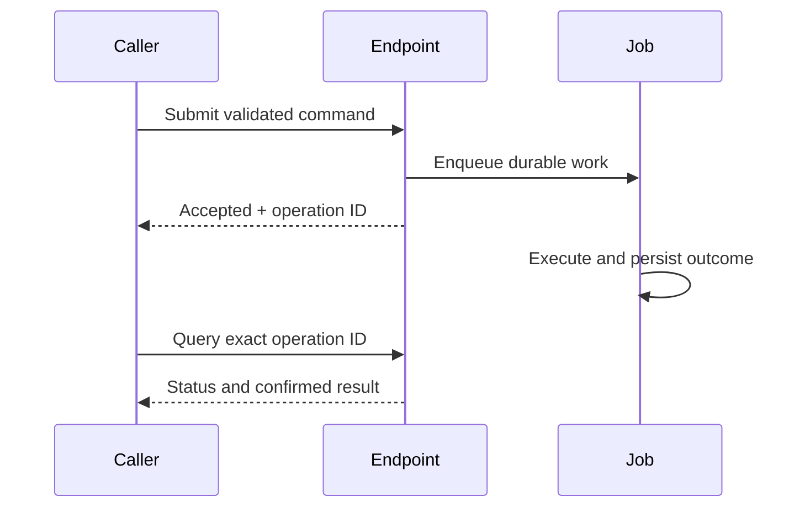

import { FlowDemo, PlaygroundStyle, useDemoPlayback, flowCatalog } from "/snippets/revo-playground.jsx";

Use an asynchronous contract when the work is too slow or retryable for one interactive request. The caller first learns that work was accepted, then follows the operation to completion.



## Explore the behavior

<FlowDemo topic="completion" />

## Define both contracts

The acceptance response should name the durable identifier. This illustrative application response is not a universal RevoEngine Job response schema:

```json
{
  "operationId": "order-1-settlement",
  "status": "ACCEPTED"
}
```

The status contract should identify pending, running, successful and failed states, and make missing or unknown operations distinguishable. Return an artifact or business result only after its required persistence boundary.

## Avoid accidental completion signals

- HTTP `202` confirms acceptance, not successful processing.
- A Job ID confirms which run to follow, not that it finished.
- Uploading bytes does not replace finalizing the Storage file.
- A UI action that received a receipt may still need a completion probe.

The caller should poll or subscribe using the exact accepted identifier. Do not infer success from the newest Job, a spinner disappearing or an empty error list.

See [Job lifecycle](/operate/jobs), [Storage uploads](/operate/storage-uploads) and [widget completion probes](/widgets/execute).
