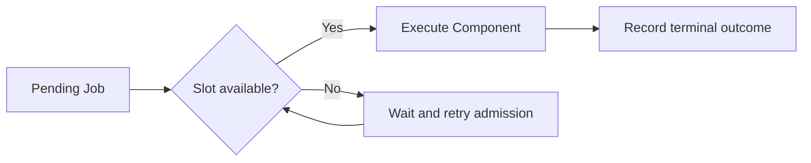
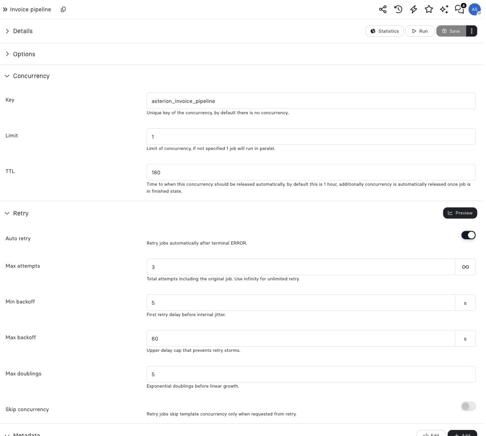

import { ConcurrencyDemo, PlaygroundStyle, useDemoPlayback, makeQueue, advanceQueue } from "/snippets/revo-playground.jsx";

Use Job concurrency when several Jobs compete for the same external account or shared resource. A configured key groups executions; the limit controls how many can run simultaneously.

## Explore the behavior

<ConcurrencyDemo />

## Configure the template

Set this object under the Job template's `options.concurrency`:

```json
{
  "key": "warehouse_sync",
  "limit": 2,
  "retryDelaySeconds": 30
}
```

If five Jobs using this key arrive together, two can execute while the other three wait for admission. A waiting Job remains pending with a concurrency wait reason. It is not a failed attempt.



## Configuration reference

| Field | Type | Default | Meaning |
| --- | --- | --- | --- |
| `key` | string | No keyed admission | Shared bucket in the instance. Use letters, digits, underscores and hyphens. |
| `limit` | integer | 1 when a key is set | Maximum admitted executions; 1–1000. |
| `retryDelaySeconds` | integer | 30 | Delay before a waiting Job retries admission; 1–3600 seconds. |
| `ttl` | integer | Legacy preference | Accepted for compatibility; ordinary Jobs use a managed renewable lease. |

The key is a configured string. It is not an expression evaluated against each Event payload. Giving all account imports the literal key `accountId` puts them in one bucket; it does not create one bucket per account.

## Choose the key deliberately

Use the same key and limit on templates that must share capacity. Different keys create independent buckets. A key such as `warehouse_sync` communicates the protected system; a key named only after a template can accidentally let several templates overload that same system.

See [key design](/patterns/coordination-keys) for the difference between capacity and duplicate protection.

## Waiting, retry and recovery

Waiting for capacity is separate from a Job's retry policy after terminal `ERROR`. Ordinary Job leases are managed while execution is active; raising legacy `ttl` does not extend an abandoned execution's permit. Operator force-run or configured automatic-retry bypass can intentionally skip template concurrency, so review those policies before treating the configured limit as unconditional.

This limit controls Job admission, not requests per second and not UI refresh ordering. For a bounded section of low-code, use [explicit concurrency admission](/patterns/low-code-concurrency). See [Job history](/operate/jobs) to inspect the wait reason and execution outcome.

## Example: serialize invoice work

The synthetic invoice pipeline uses `asterion_invoice_pipeline` and limit **1**. All Jobs using this same key share that slot: the key does not isolate each order. The pictured UI also shows a legacy TTL preference of **180 seconds**. Ordinary Jobs use the managed renewable lease described above; that field does not set their active lease duration. The separate execution timeout is **120 seconds**.

The retry policy allows **3 total attempts**, starts with a **5-second** minimum backoff and caps it at **60 seconds**. **Skip concurrency** is off, so a retry still competes for the template's slot. These sample values are configuration choices, not universal defaults or a timing guarantee.

<Frame caption="Concurrency controls overlap; retry controls later attempts after failure. Neither guarantees one business effect.">
  
</Frame>

For per-customer isolation, deliberately choose a key containing that customer's stable business identity in a supported keyed execution path. For one invoice per order, also use a unique business key and recover the existing invoice receipt; a different concurrency key alone cannot prevent duplicates.
