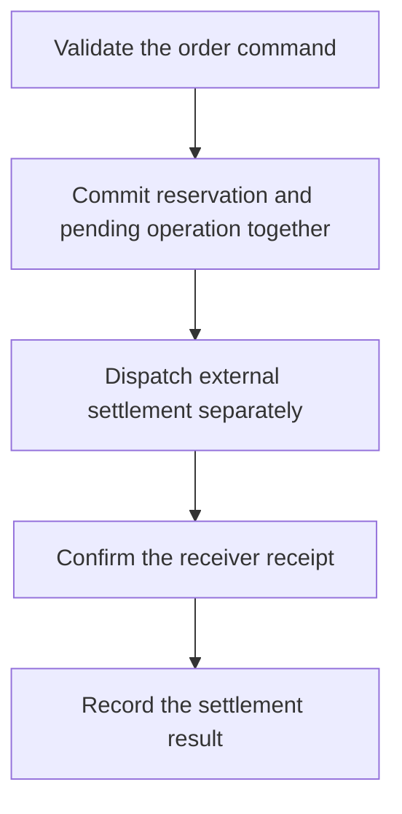

import { FlowDemo, PlaygroundStyle, useDemoPlayback, flowCatalog } from "/snippets/revo-playground.jsx";

Use a database transaction for local records that must commit together. An external HTTP service, user approval or file transfer cannot participate in that same atomic database commit.

## Explore the behavior

<FlowDemo topic="transaction" />

## Recommended boundary

Keep a reconciliation path for the gap between committing local intent and dispatching work. A local commit followed by a separate enqueue is not one atomic operation merely because both calls appear in the same Component.

## Design a visible state machine

An order may move from `PENDING` to `COMPLETED` only after a confirmed external receipt. A failure can be retryable, terminal or uncertain; keep the evidence needed to make that distinction. Use a stable [idempotency key](/patterns/idempotency) for the external operation.

Do not keep a transaction open while waiting for HTTP, an approval or a long calculation. This holds database resources and does not make the outside effect reversible.

For executable transaction syntax, see [low-code Database transactions](/low-code/database#transactions). The [order workflow tutorial](/platform/first-production-workflow) separates reservation and settlement into explicit stages.
