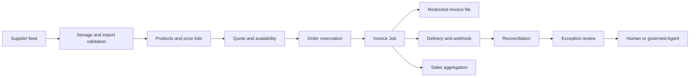

Asterion Supply is a fictional distributor of industrial equipment, tools and consumables. It sells to business customers through a portal and integrations. Buyers need current prices and stock; warehouse teams need reliable reservations; finance needs traceable invoices and reconciliation.

The example connects these departments through one business flow. Names, products and records are synthetic. It does not reuse a customer's application, pricing rules or data.

<Frame caption="A running customer portal backed by the local Asterion instance. The quote and AI answer use actual Components and the same Pricing Library. All records are synthetic.">
  
</Frame>

## What the local demonstration contains

The local reference instance contains **10,000,000 synthetic products**. A smaller working set connects customer contracts, warehouse balances, supplier feeds, orders, invoices, deliveries and exceptions.

The database, cache, identity metadata, file storage emulator, supplier endpoint, invoice renderer, mailbox and webhook receiver run locally. AI model inference uses an external provider; “local demo” does not mean offline inference. The setup uses dedicated demo identities and does not depend on customer credentials or a cloud Secret Manager.

| Check performed | Observed result |
| --- | --- |
| Quote four filters at 12.50 EUR with a 7.5% discount | `totalMinor: 4625`, no reservation |
| Change the portal quantity to ten | 115.63 EUR, calculated by the running Endpoint |
| Reserve an order and repeat its request key | Same order; no second stock reservation |
| Request more stock than is available | Rejected without creating an order |
| Run invoice processing and repeat the Job | Same invoice and delivery identity; no second email |
| Retrieve the invoice document | A real PDF from restricted Storage |
| Export issued invoices | CSV, XLSX and asynchronous NDJSON each contain 3,502 synthetic records; the background operation reaches `FINISHED` |
| Inspect delivery | One captured email in the local mailbox and a completed native webhook attempt |
| Import a deliberately imperfect supplier file | Two accepted rows and one rejected business row |
| Ask the Sales Desk, then an attached-plugin Agent, for the same quote | Both call the business tools and return 46.25 EUR |

The historical seed rows in the dashboard are demonstration records. They are not evidence that thousands of invoices were generated or delivered through the live pipeline. The example PDF is non-fiscal; real tax, numbering and accounting obligations belong to the application's implementation.

## Follow one order through the company

| Responsibility | Business result | RevoEngine capabilities |
| --- | --- | --- |
| Supplier operations | Validated product and price updates | Storage, structured import, Database operations, reviewable mappings |
| Sales | A repeatable quote using the buyer's contract | Typed Library, Component, JSON Validator, Endpoint |
| Warehouse | One reservation even when the request is retried | Transactions, primary/unique keys, row locks, audit |
| Finance | An issued invoice with consistent line totals | Job, versioned Components, Storage, retained execution evidence |
| Integration team | Confirmed delivery to a supplier or customer system | HTTP, webhooks, retry, delivery idempotency |
| Management | Sales and margin by day, customer and product family | Views, Materialized Views, refresh Schedules, dashboards |
| Operations | Actionable exception with a known owner | Events, Jobs, Assistant investigation, preview Agent workflows |

## Separate rules from orchestration

Put deterministic calculations in a Library: money in minor units, discount precedence, rounding and validation. [Build a typed library API](/build/library-authoring) demonstrates one shared price rule with its Monaco types and expected result.

An order Component reads the governed buyer and price list rather than trusting a caller-supplied final price. It validates availability and writes the order, reservation and a durable work item in one transaction. External supplier requests, invoice rendering and email delivery happen after commit. [Secure order processing](/platform/first-production-workflow) explains the transaction and recovery boundaries.

An invoice is a business record, its rendered document is a Storage file, and the delivery attempt is separate evidence. Recreating a PDF must not issue a second invoice. A failed email must not reserve stock again. Use stable business keys for each transition and retain the source version used to calculate the document.

## Model the operational records

| Record | Example key | Rule to preserve |
| --- | --- | --- |
| Product | `AST-FILTER-100` | Stable SKU; supplier identity is separate. |
| Contract price | Buyer + price-list version + SKU | Currency and validity dates travel with the price. |
| Stock balance | Warehouse + SKU | Available and reserved quantities change atomically. |
| Order | Order ID + caller request key | Repeating a request returns the same business result. |
| Invoice | Invoice ID + order ID | Issuance is idempotent; fiscal numbering follows the application's jurisdiction. |
| Delivery | Invoice ID + channel + destination | Retry only the unsettled delivery. |
| Reconciliation exception | External reference + exception kind | Repeated feed reads update the same open exception. |

[Database definitions](/operate/database-definitions) own the field and constraint choices. Enable [Audit](/operate/database-audit) before changes you need to investigate. Keep private documents and exports restricted in [Storage](/operate/storage).

## Make files part of the workflow

A supplier feed lands in Storage and passes structured validation before an import writes rows. An ambiguous mapping waits for review. A missing stock file raises an exception instead of replacing yesterday's stock with zero.

Finance can [export invoice lines](/operate/database-exports) as XLSX for a bounded human report or NDJSON for a large integration. Follow the operation to a finalized file, then track its delivery independently. [HTTP integrations](/low-code/http) cover direct transfers between authorized Storage files and external services.

## Give AI a bounded operational role

Ask the Interactive Assistant to investigate an import failure, compare a price revision or trace a delayed invoice. Give it business identifiers and a clear desired outcome. Let it inspect existing evidence before proposing a write.

For an instance with Autonomous Agent preview enabled, a reconciliation Agent can own a narrower responsibility: inspect unresolved delivery exceptions, retry an eligible delivery once, and route missing business decisions to an operator. Give it a dedicated service account, bounded tools, explicit success conditions and an escalation policy. Do not give an Agent discretionary authority to invent invoice amounts, change payment details or ignore an unresolved provider outcome.

[Approvals and plans](/ai/approvals-and-plans), [Agent configuration](/ai/agent-configuration) and [browser collaboration](/ai/browser) explain those controls. A feature's presence in a scenario does not establish that autonomous execution is enabled in every production instance.

## Put operations and AI on one dashboard

<Frame caption="A custom KPI widget and sales chart alongside a native Agent runs widget and a Database View of open exceptions. Counts and run statuses come from the running synthetic instance.">
  
</Frame>

The dashboard answers four business questions: how much data is present, what has been invoiced, which exceptions need attention, and what the reconciliation Agent actually did. Its KPI and chart widgets query governed data; the sales chart reads a Materialized View. The Agent widget links a run to its conversation rather than turning a status label into a claim of business success.

A completed run can still report an unresolved evidence boundary. In this demo an Agent created its JSON receipt, while its own readback through the file emulator failed. A separate authenticated download verified the file. Preserve that distinction in an operational handoff.

Use [custom dashboards](/operate/dashboards) for the shared operational view. Keep a named, pinned Assistant conversation for an investigation or repeatable operator workflow; pinning a chat does not create a dashboard widget. [Business plugins](/ai/business-plugins) show how the same reviewed sales actions can serve the portal Assistant and an Autonomous Agent with preview enabled.

## Connect the customer channel

The separate portal reads catalog and stock through Endpoints and streams a Sales Desk conversation through a server-side integration. The browser never receives its service-account key. The plugin resolves the demo buyer and price list on the server; a customer cannot supply an arbitrary discount or another buyer's identity.

The Sales Desk has two read-only actions: look up a product and calculate a contract quote. Placing an order remains a separate, authorized transaction. Follow [Stream an AI sales desk into a portal](/developers/customer-ai-portal) for the request, SSE event shapes and completion handling.

## Reproduce a browser check

Connect a dedicated demo terminal, select Local Access and open the customer portal in its browser. Ask the Assistant to change the quantity and verify the total through the visible form. Inspect Live Preview and retain the actual terminal execution and quote identifiers. This validates the customer channel as well as the underlying calculation.

The updated CLI's native capture was verified separately against the real local portal: change the quantity from four to ten, calculate and check the displayed €115.63 total. The finalized 5.784-second WebM measured 1920×1080 at 60 fps. This recording check used the native CLI integration harness; the Assistant-driven browser scenario has separate execution evidence. [Browser capture and recording](/ai/browser#record-or-capture-a-result) explains settings, runner compatibility and artifact checks.

## Design and measure scale separately

A large catalog, high read volume and high invoice throughput are different workloads. A ten-million-product catalog does not imply that an invoice pipeline can issue a hundred million invoices per day.

Keep the interactive demonstration small enough to understand. Use a separate, reproducible synthetic dataset for scale measurements. Record the exact database/runtime versions, dataset and index definitions, query/filter distribution, concurrency, duration, error rate, latency distribution and hardware. Exercise ingestion, pricing, transactional reservations, aggregation freshness and delivery backlog independently.

Use narrow projections and stable pagination for catalog queries, bulk writes for supplier updates, and [bounded walkers](/low-code/database#process-large-results) for processing. Precompute expensive reporting in [Materialized Views](/operate/materialized-views) with a documented freshness target. A local measurement is evidence for that configuration; it is not a platform-wide throughput commitment.

## Inspect the whole outcome

For an order, correlate its business ID with the execution, invoice, Job attempts and delivery reference. A successful Endpoint is one boundary; finance still needs an issued record and a retrievable document. A completed Job is not proof that a recipient received an email.

Use [Job outcomes](/operate/jobs#read-attempt-status-and-job-result), [Trace](/operate/traces), [Logs](/operate/logs) and [Database operations](/operate/databases) to follow each boundary. Continue with the [incident investigation workflow](/platform/incident-investigation-workflow) when a result is missing or uncertain.
