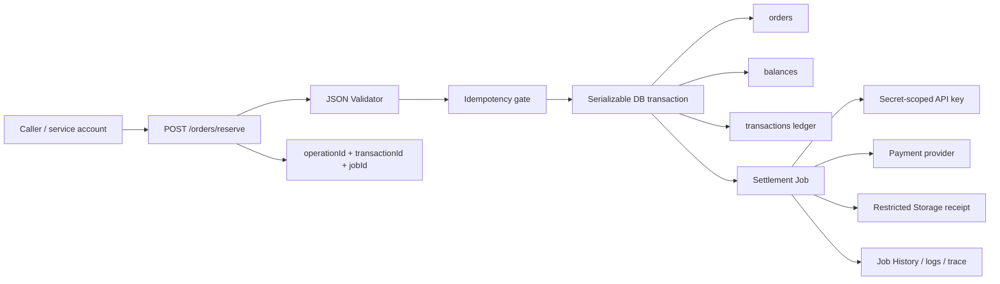

import { FlowDemo, PlaygroundStyle, useDemoPlayback, flowCatalog } from "/snippets/revo-playground.jsx";

<Info>
  This is a task-oriented guide, not the canonical API reference. Use it to see several RevoEngine capabilities working together, then follow the links to the field-by-field and generated references.
</Info>

This guide implements a payment-style reservation flow. A caller submits an existing order. RevoEngine authenticates the workload, validates the request, prevents duplicate processing, locks the relevant rows, reserves the balance, writes a transaction record, and returns an `operationId` that an operator can follow through the platform.

The example deliberately stores money in **minor units** (`1250` means `12.50`) and reads the amount, account, and currency from the governed `orders` Table. A caller cannot replace those trusted values in the request body.

<CardGroup cols={3}>
  <Card title="Protect the command" icon="key">
    A service account, least-privilege access, a JSON request guard, and an idempotency key bound the public operation.
  </Card>
  <Card title="Commit one state change" icon="database">
    A serializable transaction locks the order and balance, then writes the balance, order state, and ledger entry together.
  </Card>
  <Card title="Prove what happened" icon="timeline">
    The response, structured logs, Job History, Table audit, and Trace share stable business and platform identifiers.
  </Card>
</CardGroup>

<CardGroup cols={2}>
  <Card title="1. Model order state" href="/tutorials/order-state" icon="book-open">Create the records and validate the reservation command.</Card>
  <Card title="2. Reserve an order" href="/tutorials/order-reservation" icon="book-open">Implement the reservation Component and its HTTP Endpoint.</Card>
  <Card title="3. Settle the order" href="/tutorials/order-settlement" icon="book-open">Run external settlement as durable background work.</Card>
  <Card title="4. Verify and investigate" href="/tutorials/order-verification" icon="book-open">Exercise failure paths and follow one order through its evidence.</Card>
</CardGroup>

## Explore the behavior

<FlowDemo topic="completion" />

## Architecture

The synchronous boundary reserves funds and produces a durable ledger fact. The Job performs slower or retryable provider work **after** the database transaction commits. Never keep a database lock open while waiting for an external API.

## What this one workflow demonstrates

| Application concern | RevoEngine surface in this guide |
| --- | --- |
| Client contract | Endpoint, request guard, generated OpenAPI, status and response shaping |
| Business logic | Versioned TypeScript Components and reusable runtime declarations |
| Data and consistency | Restricted Tables, constraints, row locks, serializable transaction, audit |
| Identity and security | Service account, Permissions, Groups, ACLs, Secrets, redaction |
| External integration | Authenticated JSON egress through `api.httpCall()` |
| Background processing | Durable Job, concurrency, retry, timeout, reconciliation |
| Files and evidence | Restricted Storage folders and generated settlement receipts |
| Production operations | Operation, execution, transaction, order, and Job correlation |

The same platform model also covers realtime delivery, scheduled and event-driven work, SDK/CLI workflows, custom Node.js, frontend integrations, and governed AI. Those areas have their own guides and references instead of being forced into this sample.

## Before you begin

You need permission to create or update Components, Endpoints, Job templates, JSON Validator Components, and Tables. For production, create a dedicated service account such as `payments-runtime` and grant it only the roles and restricted-resource membership required by this workflow.

| Resource | Runtime access | Operator access |
| --- | --- | --- |
| `orders` | Read and update | Payments support and finance groups |
| `balances` | Read and update | Finance operations only |
| `transactions` | Read, insert, and update settlement fields | Finance and audit groups |
| Settlement credentials | Read one named Secret | Secret administrators only |
| Job template | Trigger | Payments runtime and selected operators |

<Warning>
  Do not put provider credentials, complete request bodies, card data, or unrestricted customer records in Component source, Endpoint metadata, logs, or Job input. Store secrets in **Secrets** and retain only the identifiers needed to investigate an operation.
</Warning>

## Reference, architecture, and operations

<CardGroup cols={2}>
  <Card title="Database runtime reference" icon="brackets-curly" href="/low-code/reference/api">
    Search exact signatures for transactions, row reads and writes, idempotency, Jobs, logs, and operation IDs.
  </Card>
  <Card title="Database definitions" icon="table-columns" href="/operate/database-definitions">
    Configure field types, constraints, indexes, references, audit, and access boundaries.
  </Card>
  <Card title="Endpoint configuration" icon="sliders" href="/operate/endpoint-configuration">
    Review every route, validation, runtime, response, and retention option.
  </Card>
  <Card title="Identity and access" icon="users-gear" href="/operate/identity-and-access">
    Configure users, service accounts, Groups, Permissions, API keys, and resource ACLs.
  </Card>
  <Card title="Jobs" icon="briefcase" href="/operate/jobs">
    Understand execution limits, retries, concurrency, long-running work, and history.
  </Card>
  <Card title="Traces and correlation" icon="timeline" href="/operate/traces">
    Investigate a distributed operation without collecting secrets.
  </Card>
  <Card title="HTTP integrations" icon="cloud-arrow-up" href="/low-code/http">
    Integrate JSON APIs, multipart forms, SSE, byte streams, callbacks, and Storage transfers.
  </Card>
</CardGroup>
