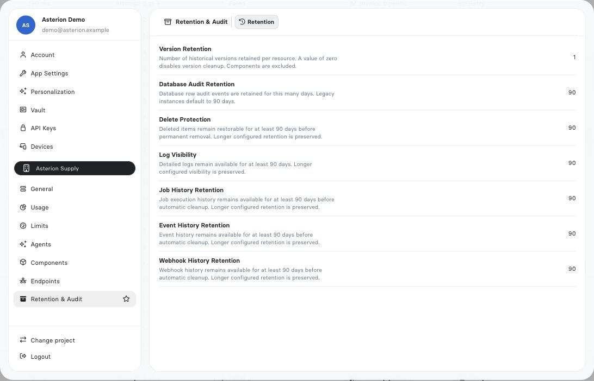

import { ScreenshotDetail } from "/snippets/screenshot-detail.jsx";

Instance settings are the control plane for behavior shared by every application in a RevoEngine instance. They expose the effective plan, usage, runtime limits, retention policy, and security defaults in one place.

<Note>
  Available values are instance-specific. Treat the values displayed in **Settings** and returned by the Config API as authoritative for the current instance; do not copy limits from another environment.
</Note>

## Who should use this page

Use instance settings when you are preparing an environment for production, diagnosing a limit or retention issue, defining the default security posture, comparing environments, or collecting governance evidence before a release.

Changing an instance setting affects a wider boundary than editing one Component, Job, or Endpoint. Review dependent workloads and make the change through an authorized administrator account.

## Open the settings surface

1. Open the user menu and select **Settings**.
2. Select an instance section in the left navigation.
3. Compare current usage with the configured allowance or policy.
4. Save editable configuration, then validate one representative workload.

The product separates personal preferences, Assistant preferences, API keys, and trusted devices from instance-wide settings. Personal configuration does not change the execution policy for other users.

## Instance sections

| Section | What it governs | Typical operator question |
| --- | --- | --- |
| **General** | Instance identity, organization, plan, expiry, base API address, and SLA | Am I changing the intended tenant and environment? |
| **Usage** | Measured AI, Transfer, Storage, Database, Jobs, Endpoints, and Webhooks consumption | What is consuming capacity over the selected period? |
| **Limits** | IAM & Groups, Jobs, Resources, and Endpoints allowances | Is this workload within its allowance? |
| **Agents** | Global instructions, default plugins, model output budget, memory, artifact retention, and security rules | What defaults and guardrails apply before an Agent starts? |
| **Components** | Instance-wide Component and shared-library controls | Which reusable-code controls apply across builders and deployments? |
| **Endpoints** | Endpoint permission identity and inherited Job execution defaults | Which account's permissions govern this execution? |
| **Retention & Audit** | Retention windows for audit data, logs, Jobs, Events, and Webhooks | How long will operational evidence remain available? |

Identity, data, and automation capacity controls are grouped under the separate **Limits** section. Legacy links to those limits sections open Limits. **Usage** retains the measured consumption views and time selector. Its information action shows retention, the exact UTC range and metering timestamps. Configure execution defaults separately under **Endpoints**; see [Endpoint configuration](/operate/endpoint-configuration).

## Identity, workspace address and authentication

**General → Identity** shows organization, instance name, plan, expiry, SLA and instance UUID. Confirm them before making a change. **General → Endpoints** shows the effective service addresses. **General → Authentication** shows accepted identity providers; use [SSO and OIDC](/operate/sso-and-oidc) for provisioning and trust boundaries.

A workspace slug is the readable address identifier. It accepts 6–30 lowercase letters, digits and hyphens, starts with a letter and ends with a letter or digit. Changing it requires an explicit URL-change acknowledgment and the current configuration version. A successful change starts a 30-day cooldown.

Old slug links stop working; they are reserved rather than kept as aliases. UUID-based links remain valid. Share the new active address and update bookmarks/integrations after the change. If the version changed while you were editing, reload the current configuration before submitting again.

## Settings tab reference

| Section | Tabs | Detailed guide |
| --- | --- | --- |
| General | Identity, Endpoints, Authentication | Identity/address above; [SSO](/operate/sso-and-oidc) |
| Usage | AI, Transfer, Storage, Database, Jobs, Endpoints, Webhooks | [Usage and soft thresholds](/platform/limits-and-quotas#usage-and-soft-thresholds) |
| Limits | IAM & Groups, Jobs, Resources, Endpoints | [Per-product enforcement](/platform/limits-and-quotas) |
| Agents | Instructions, Runtime, Memory policy | [Instance AI settings](/ai/instance-ai-settings) |
| Endpoints | Execution | [Execution identity and defaults](/operate/endpoint-configuration) |
| Components | Libraries | [Shared library policy](/build/libraries) |
| Retention & Audit | Retention | [Evidence and retention](/operate/observability), [Storage lifecycle](/operate/storage) |

“Resources” is the current Limits tab label for data capacity. The product’s data model is [Databases, Tables and Views](/operate/databases). Personal account, preferences, Vault, keys and devices are documented separately in [Personal settings](/platform/personal-settings).

<Frame caption="Retention values shown for the synthetic demo instance. Read the effective values on your own instance.">
  
</Frame>

<ScreenshotDetail src="/images/asterion/instance-retention.jpg" alt="Retention and Audit settings for version history, database audit, logs, Jobs, Events and Webhooks" width={1092} height={702} />

## Read limits correctly

<AccordionGroup>
  <Accordion title="Capacity">
    A count or byte allowance such as Databases, Storage, Secrets, users, groups, or Endpoint definitions. The UI can pair the allowance with current usage.
  </Accordion>
  <Accordion title="Runtime boundary">
    A per-execution constraint such as a Job or Endpoint timeout. Job, Endpoint, Sandbox and custom-runtime bounds differ. Use the per-product values in [Limits and quotas](/platform/limits-and-quotas) and the effective instance configuration.
  </Accordion>
  <Accordion title="Throughput">
    A rate or accumulated execution allowance, for example Endpoint requests or Job execution time. Confirm the period shown by the current instance instead of assuming a calendar window.
  </Accordion>
  <Accordion title="Retention">
    A duration after which history, logs, artifacts, or other evidence can be removed. Retention is not an execution timeout and does not make a business record durable.
  </Accordion>
  <Accordion title="Feature policy">
    A boolean or configured behavior such as scheduled webhook delivery, Agent memory, or a security rule. Component version history is always retained.
  </Accordion>
</AccordionGroup>

## Production configuration workflow

<Steps>
  <Step title="Record the effective baseline">
    Capture the instance ID, plan, relevant limits, current usage, retention windows, and security defaults. This establishes which values were in force for the release.
  </Step>
  <Step title="Map workloads to controls">
    Associate each Endpoint, Job, data store, integration, and Agent with the limits it consumes. Include retry behavior and worst-case payload sizes.
  </Step>
  <Step title="Set the governance policy">
    Configure IAM, retention, Agent security, and deployment defaults before increasing capacity. More quota does not compensate for an overly broad principal or missing lifecycle policy.
  </Step>
  <Step title="Validate representative paths">
    Exercise one synchronous Endpoint, one asynchronous Job, one data or Storage operation, and—when enabled—one Agent run. Inspect Traces, Jobs, and Activity for the same operation.
  </Step>
  <Step title="Review periodically">
    Revisit usage and retention after releases or traffic changes. Use alerts and operational reviews instead of waiting for a hard limit to interrupt production work.
  </Step>
</Steps>

## Configuration by workload

### Endpoints

Review request rate, execution-time consumption, timeout, total requests, and success rate together. A healthy average can hide a small set of slow or failing routes, so confirm the individual Endpoint in [Traces](/operate/traces) and [Observability](/operate/observability).

### Jobs and automation

Job timeout, accumulated execution time, active Event and Schedule limits, and Webhook behavior describe different failure boundaries. Size long-running work as a Job, make side effects idempotent, and plan retries before increasing the timeout. See [Jobs](/operate/jobs) and [Automation](/operate/automation).

### Data and Storage

Database size, database audit capacity, Storage capacity, network transfer, and maximum single-file size are distinct controls. Storage and transfer allowances are soft usage thresholds; exceeding them does not by itself reject a valid upload. The single-file bound, authorization and upload-session lifecycle remain enforced. Retention and file TTL are lifecycle policies described in [Storage](/operate/storage), not substitutes for capacity monitoring.

### Identity

User, group, role-group, service-identity, and API-key allowances govern different objects. Keep human and machine access separate, use least-privilege roles, and review membership even when capacity remains. See [Identity and access](/operate/identity-and-access).

### AI Agents

Agent settings provide global instructions, default plugins, a managed AI-response output ceiling, memory policy, export/artifact retention, and instance security rules. Personal Interactive Agent defaults remain account-specific, while each Autonomous Agent has its own identity, service account, policy, memory scope, and workspace. See [Agent configuration and personalization](/ai/assistant-configuration) for the complete layering model and [Agent configuration](/ai/agent-configuration) for one Agent's fields.

## API access

Administrators can retrieve effective instance configuration and usage through the **Config** operations in the [Platform API reference](/api-reference/introduction). Use the API for inventory and governance automation, but keep credentials out of reports and source control.

```bash
curl --request GET \
  --url "$REVO_API_URL/api/v1/config/instance" \
  --header "Authorization: Bearer $REVO_API_KEY"
```

<Warning>
  Configuration responses can describe security and capacity posture. Store exported snapshots with the same care as other administrative evidence, and redact tenant-specific identifiers before sharing them externally.
</Warning>

## Failure and recovery

| Symptom | Likely boundary | What to verify |
| --- | --- | --- |
| A new definition cannot be created | Object-capacity limit | Current count, deleted/restorable objects, and the relevant allowance |
| Execution ends at a repeatable duration | Runtime timeout | Effective Job or Endpoint timeout and downstream timeout behavior |
| Large file upload is rejected | File validation or upload session | Single-file bound, permissions, session state and upload error; soft Storage or transfer usage alone does not reject the upload |
| History is unavailable | Retention or visibility policy | Audit/log retention, principal permissions, and selected time range |
| Agent tool is unavailable | Agent security or plugin policy | Default plugins, per-Agent grants, blocked tools, and approvals |
| Usage appears delayed | Aggregated usage calculation | Time range, metric definition, and whether the view is an aggregate rather than a live counter |

## Release checklist

- Confirm the instance identity and environment before saving.
- Record the effective limits used by the release.
- Test just below and above important payload and timeout boundaries.
- Verify retention against contractual and audit requirements.
- Separate user, service-account, Endpoint, and Agent permissions.
- Correlate failures through Activity, Traces, logs, and Job history.
- Recheck capacity after rollout and after enabling retries or new schedules.

<CardGroup cols={3}>
  <Card title="Limits and quotas" icon="gauge-high" href="/platform/limits-and-quotas">
    Understand execution and capacity boundaries.
  </Card>
  <Card title="Security and governance" icon="shield-halved" href="/platform/security-and-governance">
    Apply least privilege and retain evidence.
  </Card>
  <Card title="Observability" icon="chart-line" href="/operate/observability">
    Verify the effect of configuration changes.
  </Card>
</CardGroup>
