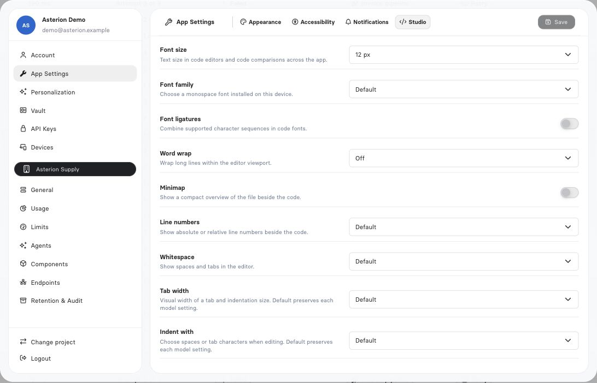

Open the user menu and select **Settings**. Personal controls change your account or working environment; instance controls apply to workloads and other users. Visibility and editing depend on your current identity and permissions.

## Find the right tab

| Section | Tabs | What you can do |
| --- | --- | --- |
| Account | Details, Metadata, Advanced, Groups, Roles, Raw JSON | Update permitted profile fields; inspect your current identity, memberships and roles |
| App Settings | Appearance, Accessibility, Notifications, Studio | Adjust presentation, editor behavior and eligible notification subscriptions |
| Personalization | Defaults, Instructions, Memory | Save personal response defaults, instructions and durable memory |
| Vault | Secrets, Integrations, Terminals, Browser profiles | Manage personal credentials, connected accounts and authorized workspaces/profiles |
| API keys | Keys | Create, inspect, expire and revoke keys belonging to your account |
| Devices | Devices | Inspect trusted browsers and revoke a registration |

Use [account security](/platform/account-security) for MFA, devices and keys, [Vault](/operate/vault) for credential grants, [terminals](/ai/terminals) for workspace access and [browser profiles](/ai/browser-profiles) for saved website logins.

## Account details and metadata

**Details** contains name, surname, phone and avatar controls. Name and surname are required; phone is validated when supplied. Changing a display name does not change your identity or permissions.

**Metadata** holds a JSON object for application-specific profile data. **Advanced** is a separate governed data field. Editing either requires its own permission. Neither field grants roles or changes Group membership. Use **Groups**, **Roles** and **Raw JSON** to inspect the current account; treat a raw account export as private administrative data.

## Appearance and accessibility

Choose **Dark**, **Light** or **System** appearance. **Compact view** reduces spacing in supported lists and detail views. These choices change presentation, not resource visibility or execution behavior.

The **Unsaved changes** option is worded “Do not ask for confirmation before leaving changed forms.” Enabling it suppresses the warning. It does not save the form automatically. Save an edit before navigating away when you need to preserve it.

## Studio preferences

These settings apply to code editors and comparisons across the application.

| Setting | Choices | Behavior |
| --- | --- | --- |
| Font size | 10–24 px; fallback 12 px | Changes editor text size |
| Font family | Default, Menlo, Consolas, Monaco, Courier New | Availability depends on installed device fonts |
| Font ligatures | On / Off | Displays supported font ligatures; does not alter source |
| Word wrap | Off / On | Wraps long lines visually |
| Minimap | On / Off | Shows or hides the code overview |
| Line numbers | Default, Absolute, Relative, Off | Controls the line-number gutter |
| Whitespace | Default, Hidden, Selection, All | Controls whitespace markers |
| Tab width | Default, 2, 4, 8 | Default preserves the editor model’s current width |
| Indent with | Default, Spaces, Tabs | Default preserves the editor model’s indentation mode |

Changing a display preference does not deploy a Component. Use [Studio](/build/web-ide) for editing, debugging, layouts and review.

<Frame caption="Personal editor preferences change how source is displayed and edited; they do not activate runtime.">
  
</Frame>

## Notifications

**Email summaries** covers unread messages from other users and important System messages. **Include attachments** controls attachment inclusion; **Attachment availability** selects 1–7 days for those links. Keep the underlying file’s access and lifecycle in mind when forwarding a message.

Eligible accounts also see API-key notifications with separate in-app and email switches. The first reminder accepts 2–365 days; the custom reminder accepts 1–365 days and must satisfy the form’s validation. A reminder does not extend or rotate a key.

Job failure subscriptions are a separate per-instance administrator opt-in. Final failures and platform errors arrive immediately; intermediate attempts can be off, grouped into a 15-minute digest or immediate. See [Job notifications](/operate/job-notifications) for exact delivery and subscriber behavior.

## Assistant preferences

**Defaults** controls progress, reasoning, planning, work mode and persona. **Instructions** holds personal guidance. **Memory** lets you inspect, replace or clear your durable memory text. Use the shared **Save** action and check for errors before leaving.

A message-level choice does not rewrite every saved default. Personal memory and instructions do not grant access or configure another Autonomous Agent. See [configuration and personalization](/ai/assistant-configuration).
